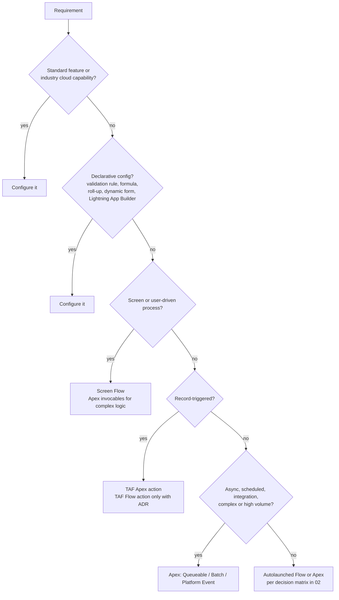

# 01 · Design Principles and Decision Records

Every solution design and every PR is assessed against these principles first. The later documents apply them to specific areas.

## 1. Core principles

| ID | Principle | Rule |
| --- | --- | --- |
| DES-01 | **Persona first** | Every change MUST start from the persona(s) it serves. The design MUST name the affected `<Persona Name>`s from the Persona Catalogue and state the capability (permission sets) and visibility (sharing) change for each. A change with no identified persona is incomplete. |
| DES-02 | **Platform first** | Use the highest rung of the platform-first ladder (§2) that meets the requirement. Moving down a rung needs a reason recorded in the design. |
| DES-03 | **One automation entry point per object** | All record-triggered logic runs through TAF ([03](03-trigger-actions-framework.md)). Record-triggered flows, Process Builder and Workflow Rules MUST NOT be created. |
| DES-04 | **Configuration over hard-coding** | Values that differ by environment or change over time (thresholds, endpoints, Ids, feature switches) MUST live in configuration (§6). Record Ids, user Ids and org URLs MUST NOT be hard-coded. |
| DES-05 | **Least privilege** | Code runs in user mode by default. Integrations get their own identity and minimal scopes. Access is granted by permission set groups and public groups ([08](08-sharing-and-record-access.md)). |
| DES-06 | **Design for volume** | Every query, sharing rule and automation is designed for the object's volume over the next 3 years, using the figures in [10](10-large-data-volumes.md). |
| DES-07 | **Observable by default** | Every entry point (trigger action, async job, invocable, REST resource, LWC controller) logs failures through Nebula Logger ([07](07-logging-and-error-handling.md)). |
| DES-08 | **Data has a lifecycle** | Every new object MUST have a retention rule ([13](13-data-retention-and-purge.md)) and a data classification before it is built. |
| DES-09 | **Reuse before build** | Search for an existing object, field, service class, LWC or flow subflow before creating a new one. Extend shared services. Copying logic between classes is prohibited. |
| DES-10 | **Boy-scout rule** | Code and metadata touched by a change SHOULD be brought into line with these standards within the scope of that change. Large remediation goes in its own story. |
| DES-11 | **Reversible** | Changes SHOULD be deployable and back-out-able without data loss. Destructive changes (field deletion, type change) need an ADR and a data backup step. |
| DES-12 | **Managed packages are not modified** | Behaviour of installed packages is extended through their supported extension points only. Package triggers, objects and settings are documented as dependencies. |

## 2. Platform-first ladder

Pick the first option that meets the requirement and the non-functional requirements (volume, latency, testability, maintainability).



## 3. Persona-first design checklist

A design MUST answer each question before build starts:

1.  Which `<Persona Name>`s use or are affected by this change?
2.  What new capability does each persona need? Which feature permission set grants it? (New permission sets follow the User Security Model Standard *(not in this repo: `reports/user-security-model-standard.md`)*.)
3.  Which records must each persona see or edit? Which public group and sharing rule grants that? ([08](08-sharing-and-record-access.md))
4.  What data classification applies to each new field or object?
5.  How is the change tested as each persona (`System.runAs` with the persona's permission set group, [06 §6](06-testing-and-mocking.md#6-persona-based-tests))?
6.  Does any integration persona need access? ([11](11-integration-and-external-client-apps.md))

## 4. Justification and Architecture Decision Records

The following MUST have an approved ADR before build:

| Trigger for an ADR | Rule ref |
| --- | --- |
| A new custom object | DM-01 |
| A new custom field on a standard object where a standard field could hold the data | DM-02 |
| A TAF Flow action | AUT-04, TAF-08 |
| Any OWD change, or a sharing mechanism other than public-group sharing rules | SHR-02 |
| A new integration or new External Client App | INT-01 |
| A new scheduled job | ASY-08 |
| A new managed package or unlocked package dependency | DES-12 |
| An exception to any MUST rule | All |

ADRs live in the repo at `docs/adr/NNNN-<slug>.md` and are linked from the story and PR.

```markdown
# ADR-NNNN: <decision title>

- Status: Proposed | Accepted | Superseded by ADR-XXXX
- Date: YYYY-MM-DD
- Deciders: <roles>
- Rules affected: <IDs, e.g. DM-01, AUT-04>

## Context
<Requirement, personas affected, volumes, constraints>

## Options considered
| Option | Pros | Cons |
|---|---|---|
| 1. <standard/declarative option> | | |
| 2. <proposed option> | | |

## Decision
<Chosen option and why the higher options on the platform-first ladder fail>

## Consequences
<Limits impact, maintenance, retention, security, test approach, rollback>
```

## 5. Naming conventions

| Component | Convention | Example |
| --- | --- | --- |
| Custom object / field API name | `PascalCase_With_Underscores__c`. No abbreviations unless standard in the domain. No team or project names. | `Enquiry_Source__c` |
| Field description and help text | MUST be populated. Description states purpose, source system and owner. |  |
| Apex class | `PascalCase`, suffix by role | `CaseService`, `CaseSelector`, `CaseDomain`, `StudentSyncQueueable`, `StudentSyncBatch`, `StudentSyncSchedulable` |
| Trigger | `<Object>Trigger` | `CaseTrigger` |
| TAF action class | `TA_<Object>_<Purpose>` | `TA_Case_SetEntitlement` |
| Test class | `<ClassUnderTest>Test` | `CaseServiceTest` |
| Interface | `I<Noun>` or a capability adjective | `IStudentGateway`, `Retryable` |
| Abstract base | `<Noun>Base` or `Abstract<Noun>` | `IntegrationCalloutBase` |
| Invocable | `<Verb><Noun>Action` | `CalculateFeesAction` |
| REST resource | `<Noun>RestResource`, URL mapping `/v1/<noun>/*` | `ApplicationRestResource` |
| LWC | `camelCase` folder | `enquirySummaryCard` |
| Flow | `<Object or Domain>_<Type>_<Purpose>` with type `SCR` (screen), `AUTO` (autolaunched), `TAF` (TAF action), `SUB` (subflow), `SCH` (scheduled) | `Case_SCR_LogEnquiry` |
| Custom permission | `<Feature>_<Capability>` | `Bypass_Triggers` |
| Custom metadata type | `<Purpose>__mdt`, singular | `Data_Retention_Policy__mdt` |
| Named credential / external credential | `<System>_<Purpose>` | `StudentSystem_API` |
| Platform event | `<Domain>_<PastTenseEvent>__e` | `Application_Submitted__e` |

## 6. Where configuration lives

| Need | Use | Avoid |
| --- | --- | --- |
| Deployable config, versioned with code (mappings, thresholds, routing tables, feature switches) | **Custom Metadata Types** | Custom settings for deployable config |
| Per-user or per-profile override, values changed by admins at runtime | **Hierarchy Custom Settings** |  |
| Translatable UI text, error messages | **Custom Labels** | Literals in Apex or LWC |
| Endpoint URLs and secrets | **Named Credentials + External Credentials** | Custom metadata or settings holding URLs with secrets |
| Feature on/off for a group of users | **Custom Permission** checked with `FeatureManagement.checkPermission()` | Profile name checks |
| Reference data maintained by the business (large, reportable) | Custom object with a retention policy | Custom metadata when rows exceed ~1,000 or business users edit them daily |
| Cached, frequently read reference data | **Platform Cache** (org partition), backed by custom metadata or object | Static maps reloaded per transaction |

Rules:

-   DES-13: Code MUST NOT branch on profile name, role name, user name or record Id. Use custom permissions.
-   DES-14: Custom metadata SHOULD be read with `<Type>__mdt.getAll()` / `getInstance()` (no SOQL row cost).

## 7. Design document contents

A solution design for a feature (Confluence or `docs/design/`) SHOULD contain:

1.  Personas and access changes (§3)
2.  Data model changes with justification ([09](09-data-model.md))
3.  Automation design: TAF actions per object and event with order numbers ([03](03-trigger-actions-framework.md))
4.  Integration design ([11](11-integration-and-external-client-apps.md))
5.  Volume and limits assessment ([10](10-large-data-volumes.md))
6.  Async and scheduling design ([12](12-asynchronous-processing.md))
7.  Retention policy ([13](13-data-retention-and-purge.md))
8.  Test approach ([06](06-testing-and-mocking.md))
9.  ADRs raised
