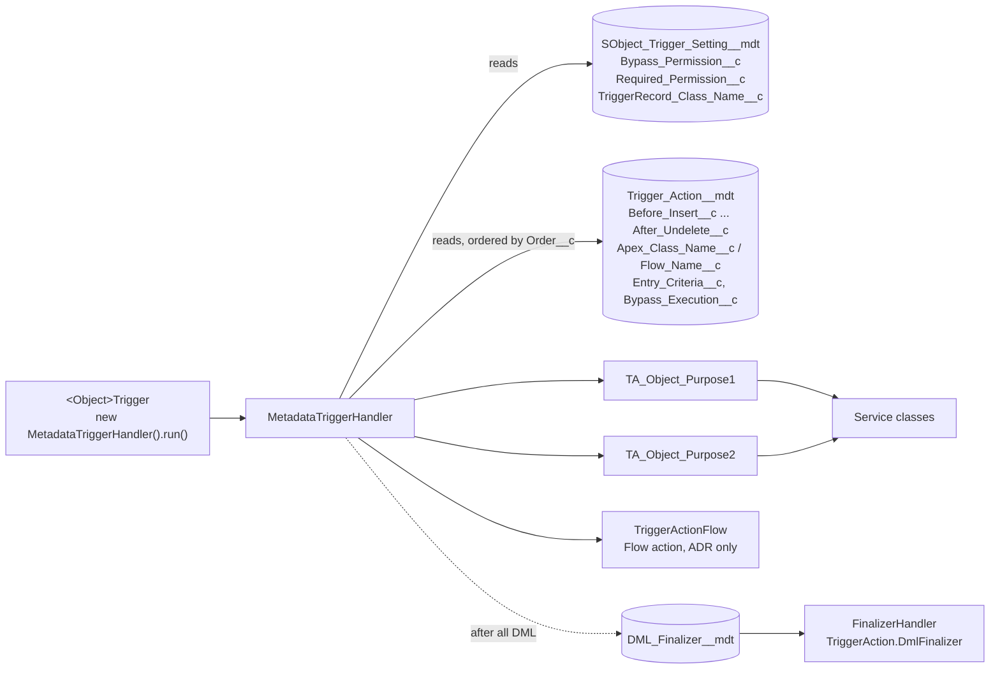

# 03 · Trigger Actions Framework (TAF)

TAF ([mitchspano/apex-trigger-actions-framework](https://github.com/mitchspano/apex-trigger-actions-framework)) is the only mechanism for record-triggered logic in unmanaged code. It is metadata-driven: one trigger per object dispatches to ordered action classes configured in custom metadata.

## 1. Rules

| ID | Rule |
| --- | --- |
| TAF-01 | Each object MUST have at most one unmanaged trigger, named `<Object>Trigger`, declaring all 7 events, whose body is only `new MetadataTriggerHandler().run();`. |
| TAF-02 | Each object with a trigger MUST have one `SObject_Trigger_Setting__mdt` row with `Bypass_Permission__c = Bypass_Triggers`. |
| TAF-03 | Each action MUST be a separate class named `TA_<Object>_<Purpose>`, implementing only the `TriggerAction.*` interfaces it needs, with a single responsibility. |
| TAF-04 | Actions MUST be thin. They filter records, then call a service class for business logic that is shared or non-trivial ([05](05-apex-design-patterns.md)). |
| TAF-05 | `Order__c` values MUST be spaced in steps of 10 per object and event. `Description__c` MUST state the business rule and reference the story or ADR. |
| TAF-06 | Actions MUST filter to the records that changed (or use `Entry_Criteria__c`) before doing work. An after-update action that processes every record in `newList` regardless of change is a defect. |
| TAF-07 | Actions MUST NOT call `Logger.saveLog()`. The entry point (or a DML finalizer) saves the log once ([07](07-logging-and-error-handling.md)). |
| TAF-08 | Flow actions (`Flow_Name__c`) require an ADR ([02 §4](02-automation-flow-vs-apex.md#4-taf-flow-action-justification)). |
| TAF-09 | Programmatic bypasses MUST be cleared in a `finally` block. |
| TAF-10 | Same-record field changes MUST be made in before contexts. After-context DML on the triggering records is prohibited. |
| TAF-11 | Callouts MUST NOT be made from actions. Enqueue async work through the shared async dispatcher ([12 §3](12-asynchronous-processing.md#3-enqueueing-from-trigger-context)). |
| TAF-12 | Every action MUST have a DML-less unit test, and every object MUST have at least one integration test that exercises the trigger through real DML ([06 §5](06-testing-and-mocking.md#5-testing-taf-actions)). |
| TAF-13 | Query results needed by several actions in one transaction SHOULD be cached in a shared selector or static map keyed by Id (TAF "avoid repeated queries" pattern). |
| TAF-14 | Managed package triggers are left in place. Their behaviour and order relative to our trigger is documented in the object's TAF metadata description. |

## 2. Components



| Metadata | Key fields |
| --- | --- |
| `SObject_Trigger_Setting__mdt` | Object API name, `Object_Namespace__c` (for package objects), `Bypass_Execution__c`, `Bypass_Permission__c`, `Required_Permission__c`, `TriggerRecord_Class_Name__c` (entry criteria) |
| `Trigger_Action__mdt` | One context lookup per event (`Before_Insert__c` … `After_Undelete__c`), `Apex_Class_Name__c`, `Order__c`, `Flow_Name__c`, `Allow_Flow_Recursion__c`, `Entry_Criteria__c`, `Bypass_Execution__c`, `Bypass_Permission__c`, `Required_Permission__c`, `Description__c` |
| `DML_Finalizer__mdt` | `Apex_Class_Name__c`, `Order__c`, `Bypass_Execution__c`, `Bypass_Permission__c`, `Required_Permission__c` |

## 3. Trigger template

```apex
trigger CaseTrigger on Case (
  before insert, after insert,
  before update, after update,
  before delete, after delete,
  after undelete
) {
  new MetadataTriggerHandler().run();
}
```

## 4. Action template

```apex
/**
 * Sets Case.Priority from the enquiry type matrix.
 * Rule: <story / ADR ref>. Context: before insert, before update.
 */
public with sharing class TA_Case_SetPriority implements TriggerAction.BeforeInsert, TriggerAction.BeforeUpdate {

  @TestVisible
  private CasePriorityService service = new CasePriorityService();

  public void beforeInsert(List<Case> newList) {
    service.applyPriority(newList);
  }

  public void beforeUpdate(List<Case> newList, List<Case> oldList) {
    Map<Id, Case> oldMap = new Map<Id, Case>(oldList);
    List<Case> changed = new List<Case>();
    for (Case c : newList) {
      if (c.Enquiry_Type__c != oldMap.get(c.Id).Enquiry_Type__c) {
        changed.add(c);
      }
    }
    if (!changed.isEmpty()) {
      service.applyPriority(changed);
    }
  }
}
```

Interface signatures:

| Interface | Method |
| --- | --- |
| `TriggerAction.BeforeInsert` | `void beforeInsert(List<SObject> newList)` |
| `TriggerAction.AfterInsert` | `void afterInsert(List<SObject> newList)` |
| `TriggerAction.BeforeUpdate` | `void beforeUpdate(List<SObject> newList, List<SObject> oldList)` |
| `TriggerAction.AfterUpdate` | `void afterUpdate(List<SObject> newList, List<SObject> oldList)` |
| `TriggerAction.BeforeDelete` | `void beforeDelete(List<SObject> oldList)` |
| `TriggerAction.AfterDelete` | `void afterDelete(List<SObject> oldList)` |
| `TriggerAction.AfterUndelete` | `void afterUndelete(List<SObject> newList)` |
| `TriggerAction.DmlFinalizer` | `void execute(FinalizerHandler.Context context)` |

Concrete SObject list types (`List<Case>`) are accepted in implementations.

## 5. Entry criteria

`Entry_Criteria__c` holds a formula evaluated per record. Only records that evaluate true are passed to the action. It requires a `TriggerRecord` subclass for the object, named in `SObject_Trigger_Setting__mdt.TriggerRecord_Class_Name__c`, that exposes typed `record` and `recordPrior` properties.

```apex
global class CaseTriggerRecord extends TriggerRecord {
  global Case record { get { return (Case) this.newSObject; } }
  global Case recordPrior { get { return (Case) this.oldSObject; } }
}
```

Example criteria: `record.Status != recordPrior.Status && record.Status = "Closed"`.

Use entry criteria for simple change detection. Keep complex filtering in Apex where it can be unit tested.

## 6. Bypass model

| Need | Mechanism |
| --- | --- |
| Data loads and bulk fixes skip all our logic | `Bypass_Triggers` custom permission set on every `SObject_Trigger_Setting__mdt.Bypass_Permission__c`, granted to the load persona only |
| Switch one action off in production without a deploy | `Trigger_Action__mdt.Bypass_Execution__c = true` (Setup edit, logged in Setup Audit Trail). Raise an incident record. |
| Code writing an object must not re-fire its triggers | `TriggerBase.bypass(Schema.SObjectType)` in `try/finally` |
| Code must skip one action | `MetadataTriggerHandler.bypass('<ClassName>')` in `try/finally` |
| Code must skip one flow action | `TriggerActionFlow.bypass('<FlowApiName>')` in `try/finally` |
| Flow must bypass an action | `TriggerActionFlowBypass` invocable, paired with `TriggerActionFlowClearBypass` |
| Action applies only to users with a capability | `Required_Permission__c` |

```apex
TriggerBase.bypass(Schema.Account.SObjectType);
try {
  update accountsToTouch;
} finally {
  TriggerBase.clearBypass(Schema.Account.SObjectType);
}
```

## 7. Recursion

TAF tracks how many times each record has passed through update contexts in `TriggerBase.idToNumberOfTimesSeenBeforeUpdate` and `TriggerBase.idToNumberOfTimesSeenAfterUpdate`. Workflow field updates, managed package DML and our own after-context DML re-fire update triggers.

```apex
public void afterUpdate(List<Contact> newList, List<Contact> oldList) {
  List<Contact> firstPass = new List<Contact>();
  for (Contact c : newList) {
    if (TriggerBase.idToNumberOfTimesSeenAfterUpdate.get(c.Id) == 1) {
      firstPass.add(c);
    }
  }
  // process firstPass only
}
```

Rules:

-   Actions that are not idempotent MUST guard against re-entry with the counters above or with change detection against `oldList`.
-   Static Boolean "has run" flags MUST NOT be used. They break partial-success DML retries and batches with multiple chunks.

## 8. DML finalizers

A DML finalizer runs once after all DML in the transaction has been processed by TAF. Use it to:

-   enqueue a single Queueable for all records touched in the transaction (in place of one enqueue per trigger invocation);
-   publish one platform event batch;
-   save the Nebula log once.

Actions register work in a static collector. The finalizer drains it.

```apex
public with sharing class FIN_EnqueueStudentSync implements TriggerAction.DmlFinalizer {
  public void execute(FinalizerHandler.Context context) {
    Set<Id> ids = StudentSyncCollector.drain();
    if (!ids.isEmpty()) {
      AsyncDispatcher.enqueue(new StudentSyncQueueable(ids));
    }
  }
}
```

When DML happens outside a trigger context and the finalizer must still run, call `TriggerBase.nowFinalize()` after the last DML. Use `TriggerBase.waitToFinalize()` before a multi-DML operation to defer finalization until `nowFinalize()`.

## 9. Order-of-execution notes

-   Managed package triggers on the same object run in an undefined order relative to ours. Our actions MUST NOT depend on values set by a package trigger in the same context.
-   Workflow field updates (managed packages) re-fire before and after update triggers once. Guard with §7.
-   Duplicate rules, validation rules and assignment rules run between before and after contexts. Before-context actions cannot rely on assignment rule results.
-   Roll-up summary updates fire parent triggers. Parent actions must tolerate child-driven updates.

## 10. Migration

Existing triggers, record-triggered flows, Process Builder, Workflow Rules and TDTM handlers move to TAF according to the TAF migration approach *(not in this repo: `reports/trigger-action-framework-migration.md`)*. New work MUST NOT add automation to the legacy mechanisms.
