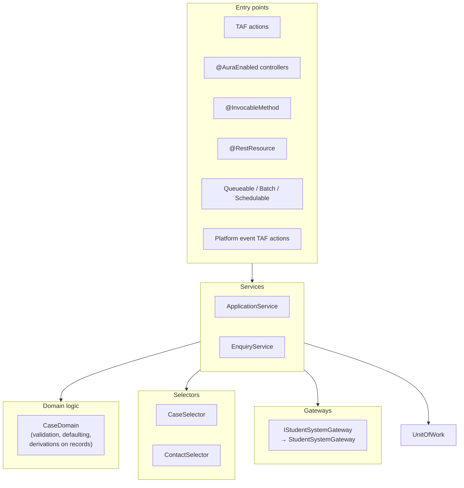

# 05 · Apex Design Patterns

How Apex is structured. Based on separation of concerns, SOLID, and the Apex Recipes reference app. The pattern classes in this document (selector, unit of work, factory, mock provider) are small, owned in our codebase, and shared by every value stream. Third-party enterprise pattern and mocking libraries are not used.

## 1. Rules

| ID | Rule |
| --- | --- |
| PAT-01 | Code is layered: **entry points** → **services** → **domain logic** and **selectors** → **gateways** (callouts). Dependencies point downward only. |
| PAT-02 | Entry points (TAF actions, controllers, invocables, REST resources, async jobs) contain no business logic beyond input handling, delegation and error handling. |
| PAT-03 | Business logic used from more than one entry point MUST live in a service class. |
| PAT-04 | Queries on shared objects MUST go through a selector class. |
| PAT-05 | Callouts MUST go through a gateway class behind an interface. |
| PAT-06 | Dependencies that need replacing in tests (selectors, gateways, services, clock, Id generation) MUST be injectable ([§3](05-apex-design-patterns.md#3-interfaces-and-dependency-injection)). |
| PAT-07 | Use an interface when there are, or will be, several implementations or a test double. Use an abstract class when implementations share state or a fixed algorithm with variable steps. Use `virtual` only when a default implementation is meaningful and overriding is expected. Classes are not `virtual` by default. |
| PAT-08 | Inheritance depth SHOULD NOT exceed 2 levels below a framework base. Prefer composition. |
| PAT-09 | Static methods are acceptable for pure, stateless utilities. Service and selector methods SHOULD be instance methods so they can be stubbed. |
| PAT-10 | Classes MUST NOT depend on concrete classes of another value stream's domain. Cross-domain calls go through that domain's public service interface. |

## 2. Layers



| Layer | Responsibility | Sharing keyword | Example |
| --- | --- | --- | --- |
| Entry point | Receive input, choose user/system mode, call service, handle errors, save log | `with sharing` (controllers), per context for others | `TA_Case_SetPriority`, `EnquiryController` |
| Service | Orchestrate a business operation across objects; transaction boundary | `inherited sharing` or `with sharing` | `ApplicationService.submit(Set<Id>)` |
| Domain | Rules that apply to a set of records of one object: validate, default, derive | `inherited sharing` | `CaseDomain.applyDefaults(List<Case>)` |
| Selector | All SOQL for an object; field lists; caching | `inherited sharing` | `CaseSelector.selectByIdWithContact(Set<Id>)` |
| Gateway | Callouts, request/response mapping | `inherited sharing` | `StudentSystemGateway.getStudent(String)` |
| Unit of work | Register and commit DML in dependency order | `inherited sharing` | `UnitOfWork` |

## 3. Interfaces and dependency injection

Use constructor injection with a default constructor for production use. This needs no framework.

```apex
public interface IStudentSystemGateway {
  StudentDto getStudent(String studentId);
  void pushEnrolment(EnrolmentDto enrolment);
}

public inherited sharing class StudentSystemGateway implements IStudentSystemGateway {
  public StudentDto getStudent(String studentId) {
    HttpRequest req = new HttpRequest();
    req.setEndpoint('callout:StudentSystem_API/v1/students/' + EncodingUtil.urlEncode(studentId, 'UTF-8'));
    req.setMethod('GET');
    req.setTimeout(20000);
    HttpResponse res = new Http().send(req);
    if (res.getStatusCode() != 200) {
      throw new IntegrationException('Student lookup failed: HTTP ' + res.getStatusCode());
    }
    return (StudentDto) JSON.deserialize(res.getBody(), StudentDto.class);
  }
  public void pushEnrolment(EnrolmentDto enrolment) { /* ... */ }
}

public with sharing class EnrolmentService {
  private final IStudentSystemGateway gateway;
  private final ContactSelector contacts;

  public EnrolmentService() {
    this(new StudentSystemGateway(), new ContactSelector());
  }

  @TestVisible
  private EnrolmentService(IStudentSystemGateway gateway, ContactSelector contacts) {
    this.gateway = gateway;
    this.contacts = contacts;
  }

  public void syncStudents(Set<Id> contactIds) {
    for (Contact c : contacts.selectByIdWithStudentId(contactIds)) {
      StudentDto dto = gateway.getStudent(c.Student_Id__c);
      // map and register updates...
    }
  }
}
```

For runtime selection of an implementation (by configuration or per environment), use a factory driven by custom metadata and `Type.forName`:

```apex
public inherited sharing class ServiceFactory {
  @TestVisible
  private static Map<System.Type, Object> mocks = new Map<System.Type, Object>();

  public static Object newInstance(System.Type interfaceType) {
    if (mocks.containsKey(interfaceType)) {
      return mocks.get(interfaceType);
    }
    Service_Binding__mdt binding = Service_Binding__mdt.getInstance(interfaceType.getName().replace('.', '_'));
    return Type.forName(binding.Implementation_Class__c).newInstance();
  }
}

// usage
IStudentSystemGateway gw = (IStudentSystemGateway) ServiceFactory.newInstance(IStudentSystemGateway.class);
```

Use the factory only where an implementation genuinely varies. Constructor injection is the default.

## 4. Selector layer

```apex
public virtual inherited sharing class CaseSelector {
  public virtual List<Case> selectById(Set<Id> ids) {
    return [
      SELECT Id, Status, RecordTypeId, ContactId, Enquiry_Type__c
      FROM Case
      WHERE Id IN :ids
      WITH USER_MODE
    ];
  }

  public virtual List<Case> selectOpenByContact(Set<Id> contactIds, Integer maxRows) {
    return [
      SELECT Id, Status, ContactId
      FROM Case
      WHERE ContactId IN :contactIds AND IsClosed = false
      WITH USER_MODE
      ORDER BY CreatedDate DESC
      LIMIT :maxRows
    ];
  }
}
```

Rules:

-   One selector per object. Methods are named `selectBy<Criteria>[With<Related>]`.
-   The class and its methods are `virtual` (or the selector implements an interface) so tests can stub them.
-   User mode by default. A system-mode variant is a separate, clearly named method (`selectByIdSystemMode`).
-   Selectors used by TAF actions SHOULD cache by Id for the transaction ([TAF-13](03-trigger-actions-framework.md)).

## 5. Unit of work

A unit of work collects DML across a service operation and commits in dependency order, with one DML per object type and a savepoint.

```apex
public virtual inherited sharing class UnitOfWork {
  private final List<Schema.SObjectType> order;
  private final Map<Schema.SObjectType, List<SObject>> inserts = new Map<Schema.SObjectType, List<SObject>>();
  private final Map<Schema.SObjectType, Map<Id, SObject>> updates = new Map<Schema.SObjectType, Map<Id, SObject>>();
  private final AccessLevel mode;

  public UnitOfWork(List<Schema.SObjectType> order, AccessLevel mode) {
    this.order = order;
    this.mode = mode;
    for (Schema.SObjectType t : order) {
      inserts.put(t, new List<SObject>());
      updates.put(t, new Map<Id, SObject>());
    }
  }

  public void registerNew(SObject record) { inserts.get(record.getSObjectType()).add(record); }
  public void registerDirty(SObject record) { updates.get(record.getSObjectType()).put(record.Id, record); }

  public virtual void commitWork() {
    Savepoint sp = Database.setSavepoint();
    try {
      for (Schema.SObjectType t : order) {
        if (!inserts.get(t).isEmpty()) Database.insert(inserts.get(t), true, mode);
        if (!updates.get(t).isEmpty()) Database.update(updates.get(t).values(), true, mode);
      }
    } catch (Exception e) {
      Database.rollback(sp);
      throw e;
    }
  }
}
```

Parent-child relationships for new records (resolving parent Ids after insert) are handled by registering a relationship and setting the lookup after the parent insert. Extend the shared `UnitOfWork` with a `registerRelationship(child, field, parent)` method when a domain needs it, so every value stream gets the same behaviour.

The unit of work is also the DML seam for tests: a test subclass overrides `commitWork()` to capture registered records without DML.

## 6. Abstract and virtual classes

### Template method (abstract)

Use when several jobs share an algorithm and differ in steps. Example: every outbound sync Queueable shares retry, logging and finalizer handling.

```apex
public abstract inherited sharing class IntegrationQueueableBase implements Queueable, Database.AllowsCallouts {
  protected final Integer attempt;
  protected IntegrationQueueableBase(Integer attempt) { this.attempt = attempt; }

  public void execute(QueueableContext ctx) {
    Logger.setAsyncContext(ctx);
    Logger.setScenario(scenarioName());
    System.attachFinalizer(new IntegrationRetryFinalizer(this));
    try {
      doWork();
    } catch (Exception e) {
      Logger.error('Integration job failed: ' + scenarioName(), e);
      throw e; // finalizer decides on retry
    } finally {
      Logger.saveLog();
    }
  }

  protected abstract String scenarioName();
  protected abstract void doWork();
  public abstract IntegrationQueueableBase nextAttempt(); // returns a copy with attempt + 1
  public Integer getAttempt() { return attempt; }
}
```

### Virtual with sensible default

Use when most implementations accept the default and a few override.

```apex
public virtual inherited sharing class RetentionHandler {
  public virtual void beforeDelete(List<SObject> records) {}           // optional hook
  public virtual Boolean isEligible(SObject record) { return true; }   // default: everything selected is eligible
}
```

### Strategy (interface)

Use when behaviour is chosen at runtime, typically from custom metadata. TAF itself is a strategy dispatcher.

```apex
public interface IFeeCalculator {
  Decimal calculate(IndividualApplication app);
}
// Fee_Calculator__mdt maps RecordType.DeveloperName -> implementing class
```

### Decision table

| Need | Use |
| --- | --- |
| Contract with several implementations, or a test double | Interface |
| Shared state and fixed algorithm, variable steps | Abstract class (template method) |
| Default behaviour, occasional override | Virtual class / virtual methods |
| Pick behaviour at runtime from config | Interface + custom metadata + `Type.forName` |
| Add behaviour around an existing implementation (logging, caching, retry) | Decorator implementing the same interface |
| Build complex test data or requests | Builder (fluent methods returning `this`) |
| Ensure one instance per transaction | Lazy static singleton (`private static Foo instance; public static Foo get()`) |

## 7. DTOs and wrappers

-   Integration payloads, LWC responses and invocable inputs/outputs use dedicated DTO classes. SObjects are not serialised directly to external systems.
-   DTOs for LWC are annotated `@AuraEnabled` on properties. Invocable DTOs use `@InvocableVariable` with `label` and `description`.
-   DTOs carry no logic beyond simple mapping methods (`toSObject()`, `static fromSObject()`).

## 8. Anti-patterns

| Anti-pattern | Why | Do instead |
| --- | --- | --- |
| "God" helper class (`Utils`, `Helper`) with unrelated methods | Hard to test, merge conflicts, hidden dependencies | Domain-specific services and focused utilities |
| Logic in triggers or controllers | Not reusable, hard to test | Service layer (PAT-02) |
| Static methods calling static methods across layers | Cannot be stubbed | Instance methods with injection (PAT-09) |
| Passing `Trigger.new` deep into services | Couples services to trigger context | Pass typed lists or Id sets |
| Inheritance for code reuse between unrelated classes | Fragile base class | Composition |
| Copy-paste of a service into another value stream | Divergence | Extend the shared service through its interface |
| Boolean parameters that switch behaviour (`doThing(records, true, false)`) | Unreadable call sites | Separate methods or an options object |
