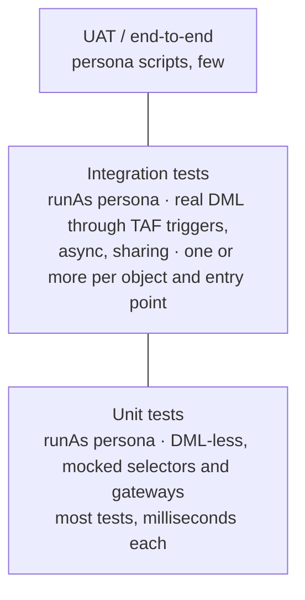

# 06 · Testing and Mocking

Tests prove behaviour, protect against regression, and run fast enough to be run on every PR. Coverage is a by-product.

Every test runs as a persona. The code under test executes inside `System.runAs` as a user built from the persona's profile, permission set group and public group membership, so every test also checks that the persona model grants the access the code needs. Mocking uses the platform Stub API and the small shared classes in this document. Third-party mocking libraries are not used.

## 1. Rules

| ID | Rule |
| --- | --- |
| TST-01 | Every Apex class MUST have a test class `<Class>Test`. Every test method MUST contain at least one meaningful assertion using the `Assert` class. |
| TST-02 | Coverage: 85% minimum per class for new and changed classes. Org-wide coverage MUST stay above 80%. Coverage without assertions does not count in review. |
| TST-03 | Tests MUST cover: positive path, negative path (expected exceptions/errors), bulk (≥ 200 records for trigger and batch paths), and access denial for a persona that should not have access. |
| TST-04 | Tests MUST NOT use `@IsTest(SeeAllData=true)`. Exceptions: objects that cannot be created in tests, with an ADR. |
| TST-05 | Test data MUST be created through the shared test data factory ([§3](06-testing-and-mocking.md#3-test-data-factory)). Inline record construction is limited to fields relevant to the test. |
| TST-06 | Tests MUST NOT depend on org data, specific record Ids or existing users. Profiles, permission set groups, public groups and custom metadata are deployed metadata and MAY be referenced by API name. |
| TST-07 | Callouts MUST be mocked with `HttpCalloutMock` or the Stub API. Tests MUST NOT call real endpoints. |
| TST-08 | Unit tests of services and TAF actions SHOULD mock selectors, gateways and DML ([§4](06-testing-and-mocking.md#4-mocking)) so they run without database work. |
| TST-09 | Each object with TAF MUST have at least one integration test with real DML through the trigger, run as a persona that performs that DML in production. |
| TST-10 | Async code is tested inside `Test.startTest()` / `Test.stopTest()`. Chained Queueables are tested one link at a time. |
| TST-11 | Tests MUST be independent and order-agnostic. No shared static state between test methods except `@TestSetup` data. |
| TST-12 | Test method names describe behaviour: `shouldSetPriorityHighWhenEnquiryTypeIsComplaint`. |
| TST-13 | Tests for `@AuraEnabled`, `@InvocableMethod` and `@RestResource` entry points MUST include one test per persona that uses the entry point, and one denial test ([§6](06-testing-and-mocking.md#6-persona-based-tests)). |
| TST-14 | LWC components MUST have Jest tests for rendering, events and wire/imperative Apex mocks ([14](14-lwc-and-ui.md)). |
| TST-15 | Tests MUST NOT contain `Test.isRunningTest()` branches in production code (APX-50). |
| TST-16 | **Every test method MUST execute the code under test inside `System.runAs(<persona user>)`**, where the user comes from `TestPersonaFactory` ([§6](06-testing-and-mocking.md#6-persona-based-tests)). This applies to unit, DML-less, integration, async and utility tests. Data setup MAY run outside the persona block. Assertions MAY run outside it. |
| TST-17 | The persona used MUST match who runs the code in production ([§6.2](06-testing-and-mocking.md#62-choosing-the-persona)). Tests MUST NOT run the code under test as a System Administrator or as the default test-context user. |
| TST-18 | Persona users MUST be created in `@TestSetup` and fetched with `TestPersonaFactory.get(...)` in each test, to keep test runs fast. |

## 2. Test pyramid



| Level | Scope | Runs as | DML | Speed target |
| --- | --- | --- | --- | --- |
| Unit | One class, collaborators mocked | Persona that calls the class in production | None | < 100 ms per method |
| Integration | Trigger → actions → services → DB, sharing, async | Persona that performs the DML in production | Real | < 5 s per method |
| Access | Entry point visibility and capability, including denial | Each persona using the entry point, plus one without access | Real | < 5 s per method |
| End-to-end | Business process in UAT | Real persona users | Real | Manual or UI automation |

Full test runs SHOULD complete in under 30 minutes. Slow tests are tracked and fixed.

## 3. Test data factory

One factory per value stream plus a shared core factory (`TestDataFactory`). Methods return unsaved records by default so tests can choose DML or no DML.

```apex
@IsTest
public class TestDataFactory {
  public static List<Account> buildPersonAccounts(Integer count) {
    Id rtId = RecordTypes.idFor(Account.SObjectType, AccountConstants.RT_PERSON_ACCOUNT);
    List<Account> result = new List<Account>();
    for (Integer i = 0; i < count; i++) {
      result.add(new Account(RecordTypeId = rtId, LastName = 'Test' + i));
    }
    return result;
  }

  public static List<Account> createPersonAccounts(Integer count) {
    List<Account> accounts = buildPersonAccounts(count);
    insert accounts;
    return accounts;
  }
}
```

Rules:

-   `build*` methods return unsaved records. `create*` methods insert.
-   Required fields and validation-rule-satisfying defaults live in the factory, so a new validation rule needs one change.
-   A fluent builder MAY be used for complex objects (`new CaseBuilder().withStatus(CaseConstants.STATUS_NEW).withContact(c).build()`).
-   Record data that a persona would not create itself (reference data, records owned by other teams) is created in `@TestSetup` outside the persona block. Records the persona creates in production are created inside the persona block, so ownership and sharing match production.

## 4. Mocking

All mocking uses the platform Stub API (`System.StubProvider`, `Test.createStub`) and `HttpCalloutMock`. Dependencies are injected through constructors ([05 §3](05-apex-design-patterns.md#3-interfaces-and-dependency-injection)). The shared `MockProvider` below covers return values, thrown exceptions, call recording and argument capture.

### 4.1 Shared `MockProvider`

```apex
@IsTest
public class MockProvider implements System.StubProvider {
  private final Map<String, Object> returns = new Map<String, Object>();
  /** Method names in call order. */
  public final List<String> calls = new List<String>();
  /** Arguments per method name, one entry per call. */
  public final Map<String, List<List<Object>>> args = new Map<String, List<List<Object>>>();

  /** Return a value, or throw it if it is an Exception. */
  public MockProvider whenCalled(String methodName, Object result) {
    returns.put(methodName, result);
    return this;
  }

  public Integer callCount(String methodName) {
    return args.containsKey(methodName) ? args.get(methodName).size() : 0;
  }

  public List<Object> argsOf(String methodName, Integer callIndex) {
    return args.get(methodName)[callIndex];
  }

  public Object handleMethodCall(
    Object stubbedObject, String methodName, System.Type returnType,
    List<System.Type> paramTypes, List<String> paramNames, List<Object> argValues
  ) {
    calls.add(methodName);
    if (!args.containsKey(methodName)) args.put(methodName, new List<List<Object>>());
    args.get(methodName).add(argValues);
    Object result = returns.get(methodName);
    if (result instanceof Exception) {
      throw (Exception) result;
    }
    return result;
  }

  public Object createStub(System.Type typeToMock) {
    return Test.createStub(typeToMock, this);
  }
}
```

Stub API limits to design around: stubbed classes must be non-static, non-final and visible to the test; static methods, constructors and private methods cannot be stubbed. This is why services, selectors and gateways use instance methods and are `virtual` or behind an interface (PAT-06, PAT-09).

### 4.2 Service unit test

```apex
@IsTest
private class EnrolmentServiceTest {
  @TestSetup
  static void setup() {
    TestPersonaFactory.createAll(new List<TestPersonas.Definition>{ TestPersonas.AUTOMATION });
  }

  @IsTest
  static void shouldSkipContactsWithoutStudentId() {
    Contact c = new Contact(Id = TriggerTestUtility.getFakeId(Contact.SObjectType));
    MockProvider selectorMock = new MockProvider()
      .whenCalled('selectByIdWithStudentId', new List<Contact>{ c });
    MockProvider gatewayMock = new MockProvider();

    EnrolmentService svc = new EnrolmentService(
      (IStudentSystemGateway) gatewayMock.createStub(IStudentSystemGateway.class),
      (ContactSelector) selectorMock.createStub(ContactSelector.class)
    );

    System.runAs(TestPersonaFactory.get(TestPersonas.AUTOMATION)) { // the sync runs as the automation user (ASY-12)
      Test.startTest();
      svc.syncStudents(new Set<Id>{ c.Id });
      Test.stopTest();
    }

    Assert.areEqual(0, gatewayMock.callCount('getStudent'), 'Gateway must not be called without a Student Id');
  }
}
```

### 4.3 HTTP callouts

```apex
@IsTest
public class StudentSystemHttpMock implements HttpCalloutMock {
  private final Integer status;
  private final String body;
  public StudentSystemHttpMock(Integer status, String body) { this.status = status; this.body = body; }
  public HttpResponse respond(HttpRequest req) {
    Assert.isTrue(req.getEndpoint().startsWith('callout:StudentSystem_API'), 'Must use the named credential');
    HttpResponse res = new HttpResponse();
    res.setStatusCode(status);
    res.setBody(body);
    return res;
  }
}
// Test.setMock(HttpCalloutMock.class, new StudentSystemHttpMock(200, '{"id":"s1"}'));
```

Use a `MultiRequestMock` (a map of endpoint → response) for flows with several callouts. Use `StaticResourceCalloutMock` for large fixture payloads. Gateway tests also run as the persona whose transaction makes the callout, which proves the persona holds the External Credential principal access (INT-11).

### 4.4 DML-less testing

-   Fake Ids: `TriggerTestUtility.getFakeId(Schema.SObjectType)`.
-   Read-only, formula and relationship fields can be set on in-memory records with `JSON.deserialize`:

```apex
Case c = (Case) JSON.deserialize(
  '{"attributes":{"type":"Case"},"Id":"' + TriggerTestUtility.getFakeId(Case.SObjectType) +
  '","IsClosed":true,"Contact":{"Id":"' + TriggerTestUtility.getFakeId(Contact.SObjectType) + '"}}',
  Case.class
);
```

-   DML is intercepted by injecting a test subclass of the shared `UnitOfWork` ([05 §5](05-apex-design-patterns.md#5-unit-of-work)) whose `commitWork()` records registered rows.
-   Formulas can be recalculated in memory with `Formula.recalculateFormulas(records)`.

### 4.5 Other test seams

| Need | Approach |
| --- | --- |
| Current date/time | Inject a `Clock` class, or `@TestVisible private static Datetime now = Datetime.now();` |
| SOSL results | `Test.setFixedSearchResults(ids)` |
| Platform events | `Test.getEventBus().deliver()` after publish; `Test.enableChangeDataCapture()` for CDC |
| Custom metadata variants | Inject records into a `@TestVisible` static cache in the reader class |
| Custom permission checks | Use a persona whose PSG includes the custom permission. For the "without" case, use a persona that lacks it. Do not assign ad-hoc permission sets to test users. |
| Queueable chains | `System.enqueueJob` in tests runs only the first job; assert the chained job was requested via a `@TestVisible` hook |
| Finalizers | Test the finalizer class directly with a stub `FinalizerContext` |
| Scheduled jobs | `System.schedule` inside `startTest/stopTest` as the automation persona, assert `CronTrigger` row |

## 5. Testing TAF actions

Unit test, no DML, run as the persona that edits the record in production:

```apex
@IsTest
private class TA_Case_SetPriorityTest {
  @TestSetup
  static void setup() {
    TestPersonaFactory.createAll(new List<TestPersonas.Definition>{ TestPersonas.EXAMPLE_PERSONA });
  }

  @IsTest
  static void shouldRecalculateOnlyWhenEnquiryTypeChanges() {
    Id caseId = TriggerTestUtility.getFakeId(Case.SObjectType);
    Case oldCase = new Case(Id = caseId, Enquiry_Type__c = 'General');
    Case newCase = new Case(Id = caseId, Enquiry_Type__c = 'Complaint');
    Case unchanged = new Case(Id = TriggerTestUtility.getFakeId(Case.SObjectType), Enquiry_Type__c = 'General');

    MockProvider svcMock = new MockProvider();
    TA_Case_SetPriority action = new TA_Case_SetPriority();
    action.service = (CasePriorityService) svcMock.createStub(CasePriorityService.class);

    System.runAs(TestPersonaFactory.get(TestPersonas.EXAMPLE_PERSONA)) {
      action.beforeUpdate(new List<Case>{ newCase, unchanged }, new List<Case>{ oldCase, unchanged.clone(true) });
    }

    Assert.areEqual(1, svcMock.callCount('applyPriority'), 'Service called once');
    List<Case> passed = (List<Case>) svcMock.argsOf('applyPriority', 0)[0];
    Assert.areEqual(1, passed.size(), 'Only the changed record is passed to the service');
  }
}
```

Integration test, real DML, bulk, as the persona that creates the records in production:

```apex
@IsTest
static void shouldSetPriorityOnBulkInsert() {
  List<Case> cases = TestDataFactory.buildCases(200, 'Complaint');
  System.runAs(TestPersonaFactory.get(TestPersonas.EXAMPLE_PERSONA)) {
    Test.startTest();
    insert cases;
    Test.stopTest();
  }
  for (Case c : [SELECT Priority FROM Case WHERE Id IN :cases]) {
    Assert.areEqual('High', c.Priority);
  }
}
```

Records inserted by integrations are tested as that integration's persona. TAF flow actions are covered only by integration tests. Each flow action MUST have one.

## 6. Persona-based tests

### 6.1 How persona users are built

Persona users in tests are built the same way production users are provisioned ([08 §1](08-sharing-and-record-access.md#1-model)): the persona's profile, its permission set group, and membership of its persona public group. Two shared `@IsTest` classes do this.

`TestPersonas` holds the API names of the metadata that implements each persona. The Persona Catalogue remains the definition of the persona. This class only references the profile, PSG and public group that implement it, and is updated in the same PR as those components.

```apex
@IsTest
public class TestPersonas {
  public class Definition {
    public final String key;
    public final String profileName;
    public final String psgDeveloperName;          // null for personas with no PSG
    public final String publicGroupDeveloperName;  // null for personas with no public group
    public Definition(String key, String profileName, String psgDeveloperName, String publicGroupDeveloperName) {
      this.key = key;
      this.profileName = profileName;
      this.psgDeveloperName = psgDeveloperName;
      this.publicGroupDeveloperName = publicGroupDeveloperName;
    }
  }

  // Baseline: minimum access profile, no PSG. Used for pure utilities and denial tests.
  public static final Definition MINIMUM_ACCESS =
    new Definition('MinimumAccess', 'Minimum Access - Salesforce', null, null);

  // Dedicated automation user for scheduled and batch jobs (ASY-12).
  public static final Definition AUTOMATION =
    new Definition('Automation', '<Automation Profile>', '<Automation_PSG>', null);

  // One entry per business, operation and integration persona, named after the Persona Catalogue entry.
  public static final Definition EXAMPLE_PERSONA =
    new Definition('ExamplePersona', '<Persona Profile>', '<Persona_PSG>', '<Persona_Public_Group>');
}
```

```apex
@IsTest
public class TestPersonaFactory {
  private static final String USERNAME_SUFFIX = '@persona.test.' + UserInfo.getOrganizationId() + '.invalid';

  /** Call once from @TestSetup. Setup DML runs as the current user to avoid mixed DML errors. */
  public static void createAll(List<TestPersonas.Definition> personas) {
    System.runAs(new User(Id = UserInfo.getUserId())) {
      Map<String, Id> profileIds = new Map<String, Id>();
      Set<String> profileNames = new Set<String>();
      Set<String> psgNames = new Set<String>();
      Set<String> groupNames = new Set<String>();
      for (TestPersonas.Definition p : personas) {
        profileNames.add(p.profileName);
        if (p.psgDeveloperName != null) psgNames.add(p.psgDeveloperName);
        if (p.publicGroupDeveloperName != null) groupNames.add(p.publicGroupDeveloperName);
      }
      for (Profile pr : [SELECT Id, Name FROM Profile WHERE Name IN :profileNames]) profileIds.put(pr.Name, pr.Id);
      Map<String, Id> psgIds = new Map<String, Id>();
      for (PermissionSetGroup g : [SELECT Id, DeveloperName FROM PermissionSetGroup WHERE DeveloperName IN :psgNames]) {
        psgIds.put(g.DeveloperName, g.Id);
      }
      Map<String, Id> groupIds = new Map<String, Id>();
      for (Group g : [SELECT Id, DeveloperName FROM Group WHERE DeveloperName IN :groupNames AND Type = 'Regular']) {
        groupIds.put(g.DeveloperName, g.Id);
      }
      if (!psgIds.isEmpty()) {
        Test.calculatePermissionSetGroup(new List<Id>(psgIds.values())); // PSG must be calculated before assignment in tests
      }

      List<User> users = new List<User>();
      for (TestPersonas.Definition p : personas) {
        Assert.isTrue(profileIds.containsKey(p.profileName), 'Profile not found: ' + p.profileName);
        users.add(new User(
          ProfileId = profileIds.get(p.profileName),
          Username = p.key.toLowerCase() + USERNAME_SUFFIX,
          Alias = p.key.left(8), LastName = 'Persona ' + p.key, Email = p.key.toLowerCase() + '@example.invalid',
          TimeZoneSidKey = 'Australia/Brisbane', LocaleSidKey = 'en_AU',
          LanguageLocaleKey = 'en_US', EmailEncodingKey = 'UTF-8'
        ));
      }
      insert users;

      List<PermissionSetAssignment> psas = new List<PermissionSetAssignment>();
      List<GroupMember> members = new List<GroupMember>();
      for (Integer i = 0; i < personas.size(); i++) {
        TestPersonas.Definition p = personas[i];
        if (p.psgDeveloperName != null) {
          Assert.isTrue(psgIds.containsKey(p.psgDeveloperName), 'PSG not found: ' + p.psgDeveloperName);
          psas.add(new PermissionSetAssignment(AssigneeId = users[i].Id, PermissionSetGroupId = psgIds.get(p.psgDeveloperName)));
        }
        if (p.publicGroupDeveloperName != null) {
          Assert.isTrue(groupIds.containsKey(p.publicGroupDeveloperName), 'Group not found: ' + p.publicGroupDeveloperName);
          members.add(new GroupMember(GroupId = groupIds.get(p.publicGroupDeveloperName), UserOrGroupId = users[i].Id));
        }
      }
      insert psas;
      insert members;
    }
  }

  public static User get(TestPersonas.Definition p) {
    return [SELECT Id FROM User WHERE Username = :(p.key.toLowerCase() + USERNAME_SUFFIX) LIMIT 1];
  }
}
```

The factory fails the test with a clear message when a referenced profile, PSG or group is missing. A test failure is the intended result when persona metadata is renamed or removed without updating `TestPersonas`.

### 6.2 Choosing the persona

| Code under test | Run as |
| --- | --- |
| `@AuraEnabled` controller, LWC-backed logic, screen-flow invocable | Each business persona that uses the component or flow (TST-13) |
| TAF action triggered by user edits | The persona(s) that edit the record in production |
| TAF action triggered by integration loads | The integration's persona |
| `@RestResource`, inbound integration services | The integration's persona |
| Queueable, Batch, Schedulable, purge engine | `TestPersonas.AUTOMATION` (ASY-12) |
| Platform event subscriber | The running user configured in `PlatformEventSubscriberConfig` (normally `AUTOMATION`) |
| Pure utilities with no data access (string, date, constants guards) | `TestPersonas.MINIMUM_ACCESS` |
| Denial tests | `TestPersonas.MINIMUM_ACCESS`, or a persona that should not have access |

When several personas use the same code path, one test per persona is required for entry points (TST-13). For shared services, use the most restricted persona that calls the service in production.

### 6.3 Example: capability, visibility and denial

```apex
@IsTest
private class EnquiryControllerTest {
  @TestSetup
  static void setup() {
    TestPersonaFactory.createAll(new List<TestPersonas.Definition>{
      TestPersonas.EXAMPLE_PERSONA, TestPersonas.MINIMUM_ACCESS
    });
    TestDataFactory.createCases(1, 'General'); // owned by the setup user; visible to the persona only via sharing
  }

  @IsTest
  static void personaCanCloseCaseSharedToItsGroup() {
    Case c = [SELECT Id FROM Case LIMIT 1];
    System.runAs(TestPersonaFactory.get(TestPersonas.EXAMPLE_PERSONA)) {
      Test.startTest();
      EnquiryController.closeCase(c.Id);
      Test.stopTest();
    }
    Assert.areEqual(CaseConstants.STATUS_CLOSED, [SELECT Status FROM Case WHERE Id = :c.Id].Status);
  }

  @IsTest
  static void personaWithoutAccessIsDenied() {
    Case c = [SELECT Id FROM Case LIMIT 1];
    System.runAs(TestPersonaFactory.get(TestPersonas.MINIMUM_ACCESS)) {
      try {
        EnquiryController.closeCase(c.Id);
        Assert.fail('Expected an access error');
      } catch (AuraHandledException e) {
        Assert.isNotNull(e.getMessage(), 'A safe error message is returned');
      }
    }
  }
}
```

Notes:

-   Sharing rules are evaluated in tests, so a persona test exercises the real sharing design (SHR-15). Criteria-based sharing recalculates synchronously on record insert in tests.
-   `User`, `PermissionSetAssignment` and `GroupMember` are setup objects. Keep them in `TestPersonaFactory.createAll`, which runs them in their own `System.runAs` block, separate from business data DML.
-   Test users do not consume licences, but the profile's user licence must exist in the org.

## 7. Tests that are not Apex

| Artefact | Test approach |
| --- | --- |
| LWC | Jest with `@salesforce/sfdx-lwc-jest`, wire adapters mocked |
| Screen flows | Flow tests where supported; UAT scripts per persona |
| Validation rules | Apex tests, run as the persona that saves the record, asserting the error. One per rule, in the object's integration test class. |
| Sharing rules | Persona tests asserting visible and not-visible records |
| Integrations | Contract tests on DTO serialisation; mocked callouts run as the integration persona; end-to-end in SIT |
| Data migrations | Reconciliation queries (counts, sums) before and after |

## 8. What reviewers check

-   Every test method calls the code under test inside `System.runAs`, with a user from `TestPersonaFactory`, and the persona matches §6.2.
-   Persona users are created in `@TestSetup`. No ad-hoc permission set assignments to test users.
-   Assertions check outcomes (field values, records created, errors raised), with messages.
-   Bulk path is tested with ≥ 200 records.
-   Negative path asserts the exception type and message key. Entry points have a denial test.
-   No `SeeAllData`, no hard-coded Ids, no sleeps or time-dependent flakiness.
-   Mocks verify interactions where behaviour is the point (e.g. gateway not called).
