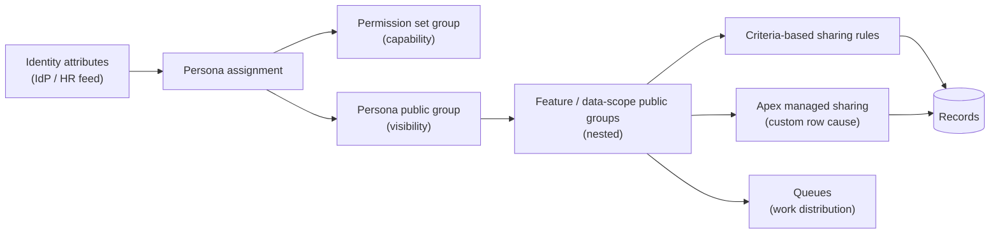

# 08 · Sharing and Record Access

Implements the record-access positions of the Persona Access Strategy *(not in this repo: `reports/persona-access-strategy.md`)* and the principles in the User Security Model Standard §4.7 *(not in this repo: `reports/user-security-model-standard.md`)*. Capability (what a user can do) comes from permission set groups. Visibility (which records) comes from sharing, driven by **public group membership**.

## 1. Model



A user's visibility is fully explained by: OWD + their public group memberships + record ownership. Roles add visibility only where a justified management-oversight need exists.

## 2. Rules

| ID | Rule |
| --- | --- |
| SHR-01 | Internal OWD is **Private** for objects holding Confidential or Restricted data. Child objects use **Controlled by Parent** where the relationship allows. External OWD is **Private**. |
| SHR-02 | OWD changes require an ADR with a sharing recalculation plan ([§6](08-sharing-and-record-access.md#6-performance-and-recalculation)). |
| SHR-03 | Access beyond ownership MUST be granted to **public groups**. Sharing rules, Apex shares, and team-style grants MUST NOT target individual users or roles. |
| SHR-04 | Public groups are of two kinds: **persona groups** (one per persona, membership = users of that persona) and **data-scope groups** (one per data scope, e.g. a business unit or record domain, members = persona groups). Sharing rules target data-scope groups. |
| SHR-05 | Group membership MUST be maintained automatically by persona provisioning (IdP-driven user provisioning or a provisioning service). Manual group membership edits in production are prohibited outside an incident. |
| SHR-06 | *Grant Access Using Hierarchies* MUST be off on persona and data-scope groups. |
| SHR-07 | Criteria-based sharing rules MUST use positive, purpose-specific criteria on indexed or low-cardinality fields (record type, status, business unit). Catch-all criteria (`CreatedById != null`) are prohibited. |
| SHR-08 | Read-only is the default share level. Read/Write goes only to groups whose personas maintain the data. |
| SHR-09 | Apex managed sharing is used only when criteria-based rules cannot express the logic (e.g. visibility depends on a related record or a junction). It MUST use a custom Apex sharing reason (custom objects) and share to public groups. |
| SHR-10 | Manual sharing MUST NOT be part of any designed process. |
| SHR-11 | Account, Case and Opportunity teams require an ADR. Team members are users, which conflicts with SHR-03. |
| SHR-12 | Restriction rules and scoping rules are allowed for narrowing visibility within a granted set (e.g. hiding a record type from a persona). They require documentation in the object's design. |
| SHR-13 | Code running in system mode MUST NOT return records to a user that the user could not see in user mode, unless the design explicitly requires it and records the reason (APX-22). |
| SHR-14 | Guest and community access follows the User Security Model Standard *(not in this repo: `reports/user-security-model-standard.md`)*: positive publication flags for guests, sharing sets for community users. |
| SHR-15 | Every sharing change MUST have persona tests asserting both visible and not-visible records (TST-13). |

## 3. Choosing a mechanism

| Need | Mechanism | Notes |
| --- | --- | --- |
| Owner and owner's manager | OWD Private + role hierarchy | Only where the hierarchy is justified. Most personas have no role. |
| All records of a type/status/business unit for a group | **Criteria-based sharing rule → data-scope public group** | Default. Recalculated by the platform. |
| Records owned by members of one group visible to another | Owner-based sharing rule (group → group) | Owner must be in a public group or queue. |
| Visibility derived from related data (junction, lookup chain, external relationship) | **Apex managed sharing → public group**, maintained by TAF actions | Custom row cause. Recalculation class implements `Database.Batchable` registered on the object's sharing reason. |
| Child records follow parent | Controlled by Parent / master-detail | No share rows needed. |
| Work queue | Queue (queue members are public groups) | Ownership by queue gives queue members access. |
| Community user's own records | Sharing set / share groups |  |
| Temporary elevated access for support | Time-bound permission set group assignment with expiry | Capability, logged. |

## 4. Group design conventions

| Group type | Name pattern | Members | Used by |
| --- | --- | --- | --- |
| Persona group | `<Persona Name>` | Users (provisioned) | Data-scope groups, queues |
| Data-scope group | `DS_<Object or Domain>_<Scope>_<Read|Edit>` | Persona groups | Sharing rules, Apex shares |
| Integration group | `<Integration Name> Integration User` | One integration user | Sharing rules for integration scope |

-   Nesting depth SHOULD NOT exceed 3 levels (user → persona group → data-scope group). Deeper nesting slows group membership calculation.
-   A group with no sharing rule, share or queue reference is deleted at the next quarterly review.

## 5. Apex managed sharing pattern

```apex
/** Maintains Programme_Plan__Share rows from Programme_Plan__c.Faculty__c. */
public without sharing class ProgrammePlanSharingService {
  // without sharing: share rows must be written regardless of the running user's access
  private static final String ROW_CAUSE = Schema.Programme_Plan__Share.RowCause.Faculty_Access__c;

  public void recalculate(List<Programme_Plan__c> plans) {
    Map<String, Id> facultyToGroup = FacultyGroupResolver.groupIdsByFaculty(); // custom metadata driven
    Set<Id> planIds = new Map<Id, Programme_Plan__c>(plans).keySet();

    delete [
      SELECT Id FROM Programme_Plan__Share
      WHERE ParentId IN :planIds AND RowCause = :ROW_CAUSE
    ];

    List<Programme_Plan__Share> shares = new List<Programme_Plan__Share>();
    for (Programme_Plan__c p : plans) {
      Id groupId = facultyToGroup.get(p.Faculty__c);
      if (groupId != null) {
        shares.add(new Programme_Plan__Share(
          ParentId = p.Id, UserOrGroupId = groupId,
          AccessLevel = 'Read', RowCause = ROW_CAUSE
        ));
      }
    }
    Database.insert(shares, false); // log failures per APX-34
  }
}
```

-   Called from a TAF after-insert/after-update action filtered to changes in the driving field.
-   Standard objects cannot have custom row causes. Use criteria-based rules for standard objects. Where Apex sharing on a standard object is unavoidable, rows use `RowCause = 'Manual'` and are removed on owner change, so the action must also run on owner change. This needs an ADR.

## 6. Performance and recalculation

| Topic | Guidance |
| --- | --- |
| Share table growth | Every Apex/rule share row is a row in `<Object>Share`. Sharing to groups keeps share rows proportional to records × groups. Sharing to users multiplies by users. This is the main reason for SHR-03. |
| Ownership skew | No single user or queue SHOULD own more than 10,000 records of an object. Integration-created records are assigned to a queue or distributed across owners. If a single owner is unavoidable, that owner has no role (or a role at the top of a flat hierarchy). |
| Group membership changes | Large membership changes (> 1,000 users or a change to a group referenced by many rules) are scheduled outside business hours. Use **Defer Sharing Calculations** for bulk restructures. |
| Parallel sharing rule recalculation | Request via Support for large objects before OWD or rule changes. |
| Implicit sharing | Child-to-parent (Account) implicit sharing adds visibility to parent accounts. Account-related designs must check what implicit read on Account exposes. |
| Rule limits | Sharing rules per object are capped (criteria-based rules have a lower cap). Prefer fewer rules with broader data-scope groups. |
| Lookup name visibility | *Require permission to view record names in lookup fields* stays on. |

## 7. Design checklist

1.  Object classification and OWD stated.
2.  Every persona's required visibility mapped to a data-scope group.
3.  Each grant mapped to a sharing rule or Apex sharing reason.
4.  Share-row estimate: records × groups, against the LDV thresholds in [10](10-large-data-volumes.md).
5.  Ownership plan for integration-created records (skew).
6.  Persona tests listed.
