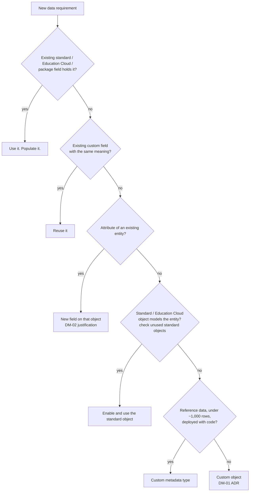

# 09 · Data Model

The data model is shared across value streams. Every addition affects storage, sharing, reporting, integrations and every future change. The default is the standard model: Salesforce core, Education Cloud and installed packages.

## 1. Rules

| ID | Rule |
| --- | --- |
| DM-01 | A new custom object MUST have an approved ADR that shows standard and Education Cloud objects were assessed and why they do not fit (§3). |
| DM-02 | A new custom field MUST have a justification in the story: no existing standard or custom field holds the data, the field's consumer is named, and the field is classified. Fields on standard objects where a standard field exists for the concept need an ADR. |
| DM-03 | Every object and field MUST have a Description, data classification (`SecurityClassification`), compliance categorisation where personal (`ComplianceGroup`), and a business owner (`BusinessOwnerId` or description). Fields shown to users MUST have Help Text. |
| DM-04 | Every new object MUST have a retention policy ([13](13-data-retention-and-purge.md)) and a volume estimate (year 1 and year 3) before build. |
| DM-05 | Fields MUST NOT be repurposed. A field whose meaning changes gets a new field and a migration. |
| DM-06 | Fields and objects MUST NOT be named after projects, teams or vendors unless they hold vendor-specific data. |
| DM-07 | Records from external systems MUST carry an External Id field (unique, case-sensitive where the source is) for upsert and reconciliation. |
| DM-08 | Picklists MUST use restricted value sets. Global value sets SHOULD be used where the same list appears on several objects. API names of values are stable codes. Labels may change. |
| DM-09 | Long text, rich text and encrypted fields MUST NOT be used as filters or in sharing criteria. |
| DM-10 | Unused fields (no data, no references) are deleted after 2 releases' notice. Fields with data are deprecated by prefixing the label with `[DEPRECATED]`, removed from layouts, and deleted after data is archived. |
| DM-11 | Objects MUST NOT exceed 500 custom fields without an ADR. Above 300 fields, skinny table eligibility and query field lists are reviewed. |
| DM-12 | Person data is modelled on Person Account/Contact and the Contact Point objects. Duplicate person attributes on other objects are prohibited. |

## 2. Assessment ladder for new data

Education Cloud and the industries data model include many objects that are available and unused (e.g. `Applicant`, `ApplicationReview`, `ApplicationDecision`, `LearnerProfile`, `PersonAcademicCredential`, `ContactContactRelation`, consent objects). The ADR for any new custom object MUST list the standard objects considered.

## 3. New object ADR content

| Section | Content |
| --- | --- |
| Entity | What real-world thing one record represents. Cardinality to existing objects. |
| Standard alternatives | Objects assessed, gap per object |
| Relationships | Lookup vs master-detail, with reasoning (§5) |
| Volume | Rows year 1, year 3, growth driver. Share rows estimate. |
| Access | OWD, sharing design, personas ([08](08-sharing-and-record-access.md)) |
| Classification | Highest classification of any field |
| Lifecycle | Retention policy, archive approach |
| Integration | Source of truth, External Id, sync direction |
| Reuse | Which other value streams could use it; how it generalises (record types, type picklist) |
| Reporting | Report types needed |

## 4. Field design

| Topic | Standard |
| --- | --- |
| Type choice | Use the narrowest correct type: Date for dates, Number/Currency with explicit scale, Checkbox for booleans, Picklist for closed sets. Text fields holding codes are 255 or less. |
| Formula fields | Allowed for display. Cross-object formulas add query cost and are non-selective in filters. Avoid formula fields in list views, report filters and SOQL `WHERE` on LDV objects. |
| Roll-up summaries | Allowed on master-detail. Each roll-up on a parent with many children adds lock contention during child DML. Over 10,000 children per parent: use an async Apex rollup. |
| Unique and External Id | External Id fields are indexed. Unique + External Id on every integration key (DM-07). |
| Encryption | Shield Platform Encryption on Restricted fields where licensed. Deterministic encryption only where filtering is required. Encrypted fields cannot be used in some filters, formulas and sharing criteria. |
| Defaults | Default values in field metadata where static. Dynamic defaults in a TAF before-insert action. |
| Required | Required at the field level only where every channel (UI, API, integration) always has the value. Otherwise use validation rules scoped by record type or channel. |
| Record types | Used where page layout, picklist values or process differ. Not used as the only data classification. Code references record types by DeveloperName (APX-48). |

## 5. Relationships

| Choose | When | Watch |
| --- | --- | --- |
| Master-detail | Child cannot exist without parent; sharing should follow parent; roll-ups needed | Parent lock contention on bulk child DML. Max 2 master-detail per object. Cascade delete. |
| Lookup | Independent lifecycle; optional parent; different sharing | Lookup skew (> 10,000 children per parent record) |
| Junction object (2 × master-detail) | Many-to-many | Sharing follows both parents (most restrictive) |
| External lookup / indirect lookup | Data in an external object | Performance depends on the external source |
| Polymorphic (`WhatId`, `OwnerId`) | Standard only | Use `TYPEOF` in SOQL |

**Lookup skew and data skew:** a parent record with more than 10,000 children causes lock contention and sharing recalculation cost. Generic "catch-all" parent records (e.g. an "Unknown" account) MUST NOT be used. Distribute or leave the lookup null.

## 6. Extensibility

-   Design objects for the concept, then specialise with record types or a `Type` picklist so other value streams can reuse the object.
-   Keep value-stream-specific fields in field sets and page layouts per record type, so the object remains coherent.
-   Avoid creating parallel objects for the same entity in different value streams. If two value streams need the same entity, the design is agreed jointly and owned by the Platform team.

## 7. Package and vendor objects

-   Installed package objects are used as provided. Custom fields on package objects are allowed with DM-02 justification and are namespaced by package prefix awareness in code (`ucinn_ascendv2__Object__c.Custom_Field__c`).
-   Where a package object duplicates a standard object (e.g. package address/email/phone objects alongside Contact Point objects), the design names one as the source of truth and the other is left empty or synced, never both maintained independently.

## 8. Metadata hygiene

| Check | Frequency |
| --- | --- |
| Fields with no data and no references | Quarterly |
| Objects with no rows and no references | Quarterly |
| Fields missing description or classification | Every PR (CI check on changed metadata) |
| Picklist values inactive but still referenced | Quarterly |
