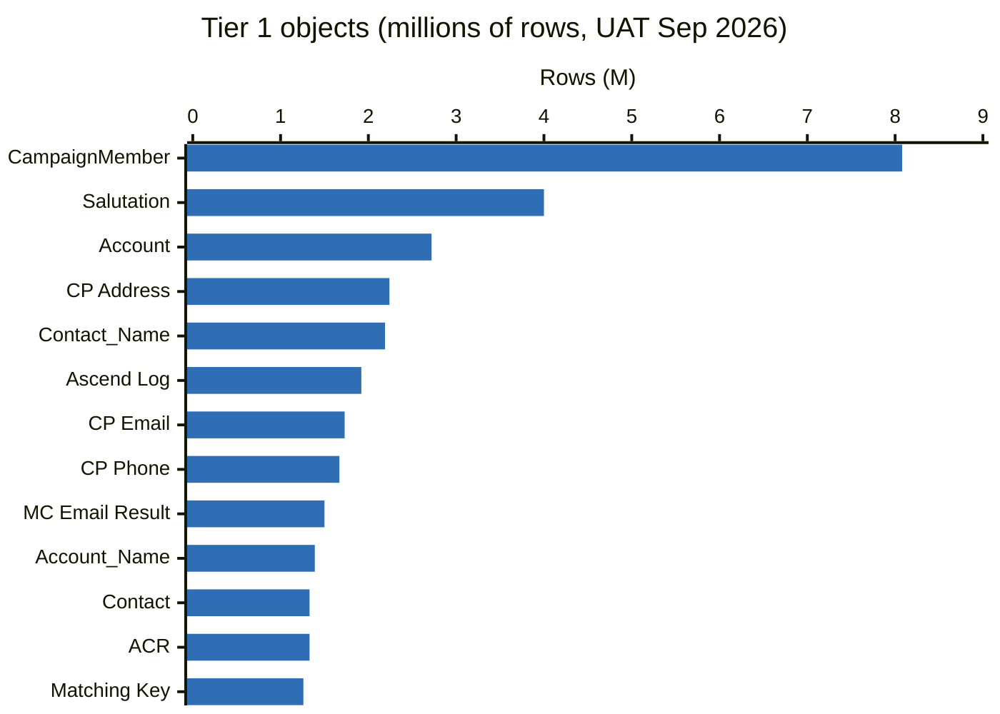

# 10 · Large Data Volumes (LDV)

Salesforce treats objects with millions of rows, or tens of thousands of users, as LDV. Several of our core objects are already there. Every design that queries, shares, reports on, or bulk-changes these objects is assessed against this document.

Reference: [Best Practices for Deployments with Large Data Volumes](https://developer.salesforce.com/docs/atlas.en-us.salesforce_large_data_volumes_bp.meta/salesforce_large_data_volumes_bp/), Well-Architected *Performant* and *Scalable*.

## 1. Rules

| ID | Rule |
| --- | --- |
| LDV-01 | Any change that adds a query, report, list view, sharing rule, automation or bulk job on a **Tier 1 or Tier 2** object (§2) MUST include an LDV assessment in the design (§9). |
| LDV-02 | SOQL on Tier 1/2 objects MUST be selective (§3) and verified with the Query Plan tool for queries that are not keyed on Id. |
| LDV-03 | Filters on Tier 1/2 objects MUST use indexed fields. Requests for custom indexes go through the Platform team to Salesforce Support. |
| LDV-04 | Bulk processing on Tier 1/2 objects MUST use Batch Apex, Apex cursors, or Bulk API 2.0. Synchronous loops over these objects are prohibited. |
| LDV-05 | No parent record SHOULD have more than 10,000 child records on a lookup or master-detail (lookup skew), and no user or queue SHOULD own more than 10,000 records of an object (ownership skew), unless the ADR addresses lock and sharing impact. |
| LDV-06 | Every Tier 1/2 object MUST have an active retention policy ([13](13-data-retention-and-purge.md)). |
| LDV-07 | Reports and list views on Tier 1/2 objects MUST filter on an indexed field with a bounded date range. |
| LDV-08 | Data loads over 100k rows MUST use Bulk API 2.0 with the load persona's trigger bypass ([03 §6](03-trigger-actions-framework.md#6-bypass-model)), in a window agreed with the Platform team. |
| LDV-09 | Volumes in §2 are re-baselined every 6 months and before any major design touching a Tier 1 object. |

## 2. Our volumes

Source: UAT Data Landscape *(not in this repo: `reports/uat-data-landscape.md`)*, aggregate counts after the Sep 2026 UAT refresh. Production is the same order of magnitude. Re-baseline with the queries in §10.

**Tier 1 (≥ 1M rows): LDV design required**

| Object | Rows | Notes |
| --- | --- | --- |
| CampaignMember | 8.08M | 1,797 campaigns. One campaign type holds 5.1M members: lookup skew on Campaign. |
| Ascend Salutation | 4.00M | ~3 per contact |
| Account | 2.72M | Person 1.33M · Household 1.33M · Organisation 52k |
| ContactPointAddress | 2.24M |  |
| Ascend Contact\_Name | 2.19M | Name history |
| Ascend `Log__c` | 1.92M | Package log. Purge candidate. |
| ContactPointEmail | 1.73M |  |
| ContactPointPhone | 1.67M |  |
| et4ae5 IndividualEmailResult | 1.50M | Marketing Cloud results. Purge candidate. |
| Ascend Account\_Name | 1.39M |  |
| Contact | 1.33M | All person-account contacts |
| AccountContactRelation | 1.33M | Household membership |
| Ascend Matching\_Key\_Value | 1.26M |  |

**Tier 2 (250k – 1M rows): LDV checks required**

| Object | Rows |
| --- | --- |
| ContactProfile | 848k |
| `STG_Enrollment__c` | 810k |
| PersonEducation | 729k |
| ConstituentRole | 634k |
| Task | 592k |
| Case | 477k |
| Ascend Service\_Indicator | 326k |
| Ascend Hard\_and\_Soft\_Credit | 266k |
| `STG_Application__c` | 262k |
| LearnerProgram | 254k |
| Ascend Payment | 253k |
| IndividualApplication | 251k |

**Tier 3 (< 250k):** standard good practice applies (e.g. AcademicTermEnrollment 232k, ProgramTermApplnTimeline 164k, `LogEntry__c` 136k, Opportunity 29k).



### What these numbers mean for design

| Observation | Design consequence |
| --- | --- |
| Account is 2.7M with one household per person | Account queries MUST filter on `RecordTypeId` or `IsPersonAccount` plus an indexed field. Account-level sharing rules evaluate against 2.7M rows. Implicit sharing from Contact/Case/Opportunity onto Account is significant. |
| CampaignMember at 8M with a few very large campaigns | Adding members to large campaigns causes lock contention on the Campaign row. Bulk member loads are serialised per campaign, run with the bypass, and use Bulk API 2.0 serial mode for the largest campaigns. Roll-ups or triggers that update Campaign from CampaignMember are prohibited. |
| Contact Point objects at 1.7–2.2M each | Lookups by `ParentId` are indexed. Searching by email/phone value MUST use SOSL or an indexed normalised field, never `LIKE`. |
| Name-history and matching-key package objects at 1.3–4M | Not business data. Retention policies in [13](13-data-retention-and-purge.md) keep them bounded where the vendor supports it. |
| Staging objects at 260k–810k | Landing tables. Processed rows are purged on a short retention period. |
| Task at 592k, 85% unrelated to a record | Task retention policy and activity archiving apply. |

## 3. Query selectivity

The query optimiser uses an index only if the filter returns fewer rows than the selectivity threshold.

| Index type | Threshold |
| --- | --- |
| Standard index | 30% of the first 1M rows + 15% of rows beyond 1M, capped at 1M rows |
| Custom index | 10% of the first 1M rows + 5% of rows beyond 1M, capped at 333,333 rows |
| `AND` of indexed filters | An index is used if any one filter is selective. If none is, an index-intersection plan is possible only when each filter is under 2× its threshold and the combined result is under the threshold. |
| `OR` | Every branch must be indexed and selective |
| `LIKE` | Only with a leading literal (`'ABC%'`). Leading wildcard is never selective. |

Worked examples on our volumes:

| Object (rows) | Standard index threshold | Custom index threshold |
| --- | --- | --- |
| Account (2.72M) | 300k + 258k = **558k** | 100k + 86k = **186k** |
| CampaignMember (8.08M) | capped at **1M** | capped at **333k** |
| ContactPointEmail (1.73M) | 300k + 110k = **410k** | 100k + 37k = **137k** |
| Case (477k) | **143k** | **47.7k** |
| ConstituentRole (634k) | **190k** | **63k** |

So `SELECT Id FROM ConstituentRole WHERE Status__c = 'Current'` (595k of 634k rows) is non-selective, and runs as a full scan, even if `Status__c` is indexed.

**Fields indexed by default:** `Id`, `Name`, `OwnerId`, `CreatedDate`, `SystemModstamp`, `RecordTypeId`, lookup and master-detail fields, External Id fields, unique fields, `Email` on Contact/Lead, `Division`. `LastModifiedDate` is not indexed: filter on `SystemModstamp`.

**Non-selective patterns:** `!=`, `NOT IN`, `NOT LIKE`, `EXCLUDES`, leading-wildcard `LIKE`, comparisons with `null` on non-indexed fields (custom indexes exclude nulls unless Support enables null indexing), non-deterministic formula fields, cross-object formula fields, `OR` across unindexed fields.

### Checking a query

-   Developer Console → Query Plan, or REST: `GET /services/data/v67.0/query?explain=<SOQL>`.
-   A plan with `Cost < 1` and `leadingOperationType = Index` is selective. `TableScan` with cost ≥ 1 is not.
-   Include the plan output in the PR for new queries on Tier 1/2 objects.

## 4. Indexing approach

| Option | Use when | How |
| --- | --- | --- |
| External Id | Integration keys, frequent exact-match lookups | Field setting (self-service) |
| Unique | Natural business keys | Field setting |
| Custom single-column index | Frequent filter on a non-key field with good selectivity | Salesforce Support case. Include the query, plan output and object volume. |
| Two-column index | Frequent filter on two fields together, e.g. `RecordTypeId` + `Status__c`, or sort + filter | Support case. Useful for list views and keyset paging. |
| Null-value index | Filters on `field = null` that must be selective | Support case |
| Deterministic formula index | Formula referencing only same-record fields and no dates/`NOW()` | Support case |
| Deterministic encryption | Encrypted field that must be filtered | Shield configuration |

Index requests are recorded in the object's design note with the query they serve. Indexes that no query uses are removed.

## 5. Skinny tables

A skinny table is a Salesforce-maintained copy of selected fields from one object. It avoids the internal join between standard and custom field tables and is used automatically by the optimiser for reports, list views and SOQL that read only its columns.

| Aspect | Detail |
| --- | --- |
| Created by | Salesforce Support on request |
| Columns | Up to 100, from one object only. No formula fields that reference other objects. |
| Contents | Active rows only (no soft-deleted rows) |
| Sync | Kept in sync automatically |
| Sandboxes | Copied to Full sandboxes. Other sandbox types need a separate request. |
| Maintenance | Adding a field means a new Support request. Field type changes can invalidate the table. |
| Best fit | Tier 1 objects with heavy read-only reporting or list views on a stable field set, e.g. Account or CampaignMember reporting |

Request a skinny table only after query tuning and indexes are exhausted, with evidence of slow reports or list views (Event Monitoring or user-reported timings).

## 6. Data skew

| Skew type | Threshold | Symptom | Mitigation |
| --- | --- | --- | --- |
| Ownership skew | \> 10,000 records per owner | Slow sharing recalculation on owner/role changes | Distribute owners; owner with no role; queue ownership |
| Lookup skew | \> 10,000 children per parent | `UNABLE_TO_LOCK_ROW` during child DML | Avoid catch-all parents; serial bulk loads grouped by parent; no roll-ups from skewed children |
| Account data skew | \> 10,000 Contacts/Cases/Opps per Account | Locks and sharing recalculation on Account | Same as lookup skew. Our household model is 1:1 and safe. Organisation accounts must be checked. |

## 7. Bulk processing at volume

| Approach | Rows | Notes |
| --- | --- | --- |
| Queueable + Apex cursor | Up to tens of millions | Fetch pages from a `Database.Cursor` across chained Queueables ([12 §4](12-asynchronous-processing.md#4-choosing-an-async-mechanism)) |
| Batch Apex with `QueryLocator` | Up to 50M | Default for scheduled bulk work. Scope size tuned (§8). |
| Bulk API 2.0 | Millions | External loads and extracts. PK chunking for extracts. |
| Data Loader / ETL | Millions | Through the load persona with bypass. Serial mode for skewed parents. |

## 8. Tuning batch scope size

| Situation | Scope |
| --- | --- |
| Simple field updates, no triggers fire | 2,000 |
| Default | 200 |
| Records with heavy TAF actions, sharing changes or roll-ups | 50–100 |
| Callouts per record | ≤ 100 (callout limit) |
| Skewed parents | Order by parent Id; smaller scope |

## 9. LDV assessment template

```markdown
### LDV assessment: <change>
- Objects touched and tier: <Object (rows, tier)>
- New queries: <SOQL> → plan: <index used / cost>
- New filters on reports/list views: <fields, indexed?>
- Sharing impact: <rules added, estimated share rows>
- DML volume per transaction / per day: <n>
- Skew risk: <parents/owners with > 10k children?>
- Async approach: <batch/cursor, scope size>
- Retention policy: <Data_Retention_Policy__mdt row>
- Index or skinny table requests: <none / details>
```

## 10. Re-baselining volumes

Aggregate-only queries, run against UAT after each refresh and against production by the Platform team:

```bash
for obj in Account Contact CampaignMember Case Task ContactPointEmail ContactPointPhone ContactPointAddress ConstituentRole PersonEducation IndividualApplication LearnerProgram; do
  sf data query -q "SELECT COUNT() FROM $obj" --target-org uat --json | jq -r --arg o "$obj" '"\($o),\(.result.totalSize)"'
done
```

```sql
-- Skew checks (aggregate only)
SELECT CampaignId, COUNT(Id) n FROM CampaignMember GROUP BY CampaignId HAVING COUNT(Id) > 10000
SELECT OwnerId, COUNT(Id) n FROM Case GROUP BY OwnerId HAVING COUNT(Id) > 10000
SELECT AccountId, COUNT(Id) n FROM Contact GROUP BY AccountId HAVING COUNT(Id) > 10000
```

Aggregate queries over Tier 1 objects can time out. Run them per record type or per `CALENDAR_YEAR(CreatedDate)` if needed.
