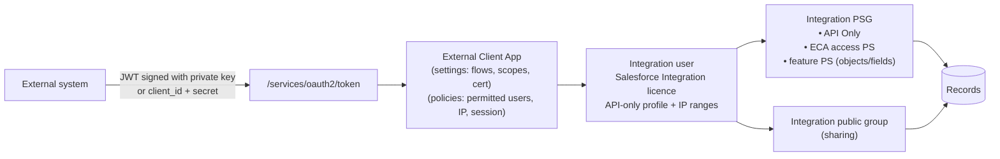
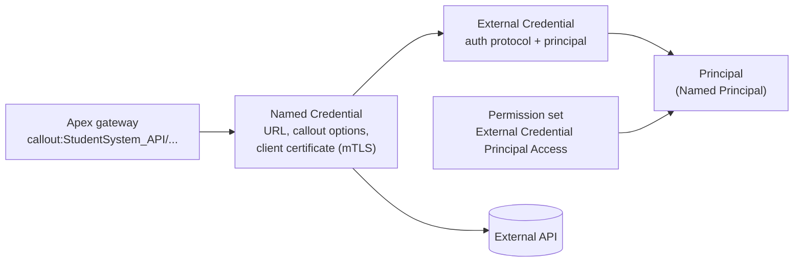

# 11 · Integration and External Client Apps

Covers how external systems authenticate to Salesforce (inbound), how Salesforce calls external systems (outbound), and which integration patterns to use. Integration identities follow the integration persona template in the User Security Model Standard §3.2 *(not in this repo: `reports/user-security-model-standard.md`)*. Certificate and mTLS context: Integration Authentication: mTLS, JWT *(not in this repo: `reports/integration-auth-mtls-jwt.md`)*.

Since Spring '26, new Connected Apps cannot be created (Setup or Metadata API) without a Support request. **External Client Apps (ECAs)** are the mechanism for every new inbound integration.

## 1. Rules

| ID | Rule |
| --- | --- |
| INT-01 | Every new integration MUST have an ADR covering pattern, direction, volume, identity, authentication flow, data scope and error handling. |
| INT-02 | Inbound OAuth integrations MUST use an **External Client App**. New Connected Apps MUST NOT be requested. |
| INT-03 | Each integrating system MUST have its own integration user (1:1). Integration users MUST NOT be shared between systems or used by people. |
| INT-04 | Integration users MUST use the **Salesforce Integration** user licence and an API-only profile cloned per network trust boundary, with Login IP Ranges set. |
| INT-05 | All integration permissions MUST be granted through one permission set group per integration, containing: the API Only permission set, a permission set granting access to the integration's ECA, and feature permission sets scoped to the exact objects and fields used. No permission sets assigned directly to the user. No role. |
| INT-06 | The ECA policy MUST set **Permitted Users = Admin approved users are pre-authorized**, with access granted only via the integration's permission set. |
| INT-07 | The ECA policy MUST set **IP Relaxation = Enforce IP restrictions**, unless the ADR records why the source cannot have fixed egress IPs. |
| INT-08 | OAuth flows: **JWT Bearer** (certificate) is the default for server-to-server. **Client Credentials** is allowed where the client cannot sign JWTs. **Authorization Code + PKCE** for user-delegated apps. Username-Password and User-Agent flows MUST NOT be used, and MUST be blocked org-wide. |
| INT-09 | OAuth scopes MUST be the minimum needed. `api` is the default. `full`, `web` and `refresh_token` require justification. Scopes gate which APIs can be called. Data access comes from permission sets. |
| INT-10 | Consumer secrets, private keys and certificates MUST NOT be committed to source control. ECA global OAuth settings (consumer key/secret, certificate) are managed per org, outside the repo. |
| INT-11 | Outbound callouts MUST use **Named Credentials with External Credentials**. Access to an external credential principal MUST be granted by permission set. Endpoints, tokens and keys MUST NOT appear in code, custom metadata or custom settings. |
| INT-12 | Certificates (JWT signing, mTLS) MUST have an owner and an expiry alert at least 60 days ahead. |
| INT-13 | Inbound data MUST be upserted on External Id fields (DM-07). Integrations MUST be idempotent: replaying a message produces the same result. |
| INT-14 | Every integration MUST log through Nebula Logger with tag `Integration:<System>` and a correlation Id carried end-to-end ([07](07-logging-and-error-handling.md)). |
| INT-15 | Integration users that load data in bulk use the trigger bypass custom permission only when the ADR states which automation is intentionally skipped and how its effect is reproduced. |
| INT-16 | Existing Connected Apps are migrated to ECAs when the integration is next changed, or by the migration programme. Third-party packaged Connected Apps that cannot migrate are installed and hardened (§6). |

## 2. Inbound: External Client App design



### 2.1 Settings and policies

ECAs separate developer-owned **settings** from admin-owned **policies**.

| Layer | Metadata type (Metadata API) | In source control | Contents |
| --- | --- | --- | --- |
| App header | `ExternalClientApplication` | Yes | Name, contact, distribution state (Local) |
| OAuth settings | `ExtlClntAppOauthSettings` | Yes | Enabled flows, scopes, callback URLs |
| Global OAuth settings | `ExtlClntAppGlobalOauthSettings` | **No** | Consumer key/secret, certificate, sensitive values |
| OAuth policies | `ExtlClntAppOauthConfigurablePolicies` | Yes | Permitted users, IP relaxation, refresh token policy, session timeout, client credentials run-as user |
| App policies | `ExtlClntAppConfigurablePolicies` | Yes | Enabled state, permission set / profile assignment |

Verify type names against the current Metadata API Developer Guide before automating deployment. ECAs are **Local** (single org) for our own integrations. Packaged ECAs (2GP) apply only to ISV-distributed apps.

### 2.2 ECA configuration standard

| Setting | Value |
| --- | --- |
| Distribution | Local |
| Name | `<Integration Name>` (matches the integration persona) |
| Contact email | Team mailbox of the integration owner |
| OAuth flows | JWT Bearer **or** Client Credentials (one, per INT-08) |
| Scopes | `api` (add others only per INT-09) |
| Require secret for web server flow | On (where web server flow is used) |
| PKCE | Required (where authorization code flow is used) |
| Client Credentials run-as user | The integration user |
| Permitted users | Admin approved users are pre-authorized |
| Permission set access | `HPP External Client App <App Name>` (inside the integration PSG) |
| IP relaxation | Enforce IP restrictions |
| Refresh token policy | Not issued for JWT / Client Credentials. For user-delegated apps: rotation on, expire if unused for 30 days. |
| Session timeout | 2 hours or lower |
| Token revocation runbook | Documented in the integration ADR |

### 2.3 Choosing the OAuth flow

| Scenario | Flow | Notes |
| --- | --- | --- |
| Server-to-server, client can sign JWTs | **JWT Bearer** | Certificate uploaded to the ECA. Private key in the client's secret store. No shared secret. |
| Server-to-server, client cannot sign JWTs (SaaS with limited auth options) | **Client Credentials** | Run-as user set in policy. Secret in a vault. Rotate with the Staged Credentials process (new secret alongside old, test, promote). |
| Middleware acting for many systems | JWT Bearer, one ECA and integration user per source system | Systems behind one middleware gateway may share a profile (same egress IPs). Each keeps its own user and PSG. |
| App acting on behalf of a signed-in Salesforce user | **Authorization Code + PKCE** | Refresh token rotation on. |
| CLI or device with limited input | Device Flow | Admin-approved users only. |
| External IdP token to Salesforce token | Token Exchange | Identity preserved end-to-end. |
| Username-Password, User-Agent | **Prohibited** | Block in OAuth and OpenID Connect Settings. |

### 2.4 Integration user template

| Component | Value |
| --- | --- |
| User licence | Salesforce Integration |
| Permission set licence | Salesforce API Integration |
| Profile | Clone of *Minimum Access – API Only Integrations*, named `<Integration Name> Integration User`, Login IP Ranges set |
| Role | None |
| PSG | `<Integration Name> Integration User` = `HPP API Only User` + `HPP External Client App <App Name>` + feature permission sets |
| Public group | `<Integration Name> Integration User`, used by sharing rules for the integration's data scope |
| Password | None set. Users cannot log in interactively. |
| Logging level | Nebula `INFO` (LOG-08) |

### 2.5 Organisation-level hardening

-   Block Username-Password and User-Agent flows in OAuth and OpenID Connect Settings.
-   Keep the *Approve Uninstalled Connected Apps* and *Use Any API Client* permissions out of all persona PSGs (High-Privilege Permissions).
-   Target state: **API Access Control** enabled, so only approved ECAs and Connected Apps can call APIs. Enable once every active integration is on an approved app.
-   Review *External Client App OAuth Usage* and *Connected Apps OAuth Usage* quarterly. Revoke unused tokens and remove apps with no usage in 90 days.

## 3. Outbound: Named Credentials



| Setting | Standard |
| --- | --- |
| Named Credential | One per external API base URL. Name `<System>_<Purpose>`. *Generate Authorization Header* on. *Allow Formulas in HTTP Header* only when custom headers are needed. |
| External Credential | One per auth mechanism per system. Protocol: OAuth 2.0 (Client Credentials / JWT Bearer), AWS Signature v4, or Custom (API key headers stored as principal parameters). |
| Principal type | **Named Principal** for system-to-system. Per-User only for user-delegated APIs. |
| Principal access | Granted by a permission set included in the PSG of the personas or integration users whose transactions make the callout. |
| mTLS | Client certificate set on the Named Credential. Certificate expiry tracked (INT-12). |
| Legacy | Legacy Named Credentials and Remote Site Settings with hard-coded auth are migrated when touched. |

Custom header using a principal parameter:

```
Header name: x-api-key
Value:       {!$Credential.StudentSystem_ApiKey.ApiKey}
```

## 4. Integration patterns

Based on the Salesforce Integration Patterns and the Well-Architected *Data Integration* decision guide.

| Pattern | When | Salesforce mechanism |
| --- | --- | --- |
| Remote call-in (sync, external → SF) | External system creates/updates records | Standard REST, Composite / sObject Collections, upsert by External Id. Custom Apex REST only when a server-side transaction or business logic is needed. |
| Bulk inbound | \> 10k records per run | Bulk API 2.0, upsert by External Id, load persona bypass where justified (INT-15) |
| Request-reply (sync, SF → external) | User needs the answer now, < 10 s | Apex callout via Named Credential from a controller or screen-flow invocable. Continuation for long-running calls from LWC. |
| Fire-and-forget (async, SF → external) | Notify external system of a change | Platform event or CDC consumed by middleware via Pub/Sub API; or Queueable callout with retry |
| Batch data sync | Periodic reconciliation | Middleware + Bulk API 2.0; or Batch Apex with callouts |
| UI update from external change | External change must appear to users | Inbound API + platform event → LWC `empApi` / `lightning/empApi` |
| Data virtualisation | Read external data without storing it | Salesforce Connect external objects |
| Staging + transform | Source data needs validation/transformation before core objects | Landing object (`STG_*`), processed by Queueable/Batch, purged on retention ([13](13-data-retention-and-purge.md)) |

### 4.1 Event-driven integration

-   **Change Data Capture** for replicating Salesforce changes to external stores. Select only the objects needed. Use enrichment fields on the CDC channel where consumers need context.
-   **Platform events** for business events with a defined schema (`<Domain>_<PastTenseEvent>__e`). Publish after commit (`PublishBehavior = PublishAfterCommit`) for events describing committed data.
-   External subscribers use the **Pub/Sub API** (gRPC). CometD/Streaming API is legacy.
-   Apex subscribers to platform events run through TAF (platform event objects support triggers; `after insert` only). Configure `PlatformEventSubscriberConfig` to set the running user and batch size.
-   Monitor event allocation (daily delivery and publishing limits) as part of the integration ADR.

## 5. Custom Apex REST APIs

```apex
@RestResource(urlMapping='/v1/applications/*')
global with sharing class ApplicationRestResource {
  @HttpPost
  global static void submit() {
    RestResponse res = RestContext.response;
    Logger.setScenario('FutureStudents.ApplicationApi');
    try {
      ApplicationRequest req = (ApplicationRequest) JSON.deserializeStrict(
        RestContext.request.requestBody.toString(), ApplicationRequest.class
      );
      ApplicationResponse out = new ApplicationService().submitFromApi(req);
      res.statusCode = 200;
      res.responseBody = Blob.valueOf(JSON.serialize(out));
    } catch (ApplicationException e) {
      Logger.warn('Application API validation error', e).addTag('Integration:ApplicationApi');
      res.statusCode = 422;
      res.responseBody = Blob.valueOf(JSON.serialize(new ApiError('VALIDATION', e.getMessage(), Logger.getTransactionId())));
    } catch (Exception e) {
      Logger.error('Application API failure', e).addTag('Integration:ApplicationApi');
      res.statusCode = 500;
      res.responseBody = Blob.valueOf(JSON.serialize(new ApiError('SERVER_ERROR', 'Unexpected error', Logger.getTransactionId())));
    } finally {
      Logger.saveLog();
    }
  }
}
```

Rules:

-   Versioned URL (`/v1/`). Breaking changes create `/v2/`.
-   Strict deserialisation of typed request DTOs. Response DTOs never expose SObjects directly.
-   Error body: `{ "code", "message", "correlationId" }`. No stack traces.
-   Idempotency: accept a client-supplied idempotency key or upsert on External Id.
-   Bulk-capable: accept arrays where the client sends more than one record per call.

## 6. Existing Connected Apps

| Type | Action |
| --- | --- |
| Local OAuth Connected App we own | App Manager → *Migrate to External Client App*. The consumer key and secret are preserved. The Connected App becomes read-only. Test in a sandbox first. Use side-by-side cutover for high-volume integrations. |
| Connected App using Username-Password or User-Agent flow | Refactor to JWT Bearer or Client Credentials on a new ECA before migration. |
| Managed-package / ISV Connected App | Cannot migrate. Install it (if uninstalled), set Permitted Users to admin-approved, assign via permission set, enforce IP restrictions. |
| Salesforce first-party apps (CLI, Data Loader, mobile) | Maintained by Salesforce. Restrict via permission set and API Access Control. |

## 7. Integration ADR checklist

1.  Pattern (§4) and direction
2.  Volumes: records per run, runs per day, peak; API calls per day against the org's daily API allocation
3.  Identity: integration user, PSG, public group, ECA or Named Credential
4.  Auth flow and credential lifecycle (rotation, expiry, owner)
5.  Data scope: objects and fields, classification of each
6.  Error handling, retry, idempotency, correlation Id
7.  Automation impact on Salesforce (which TAF actions run for integration DML; bypass decisions)
8.  Monitoring: Nebula tags, alerting, owner
9.  Retention of staging or integration records
