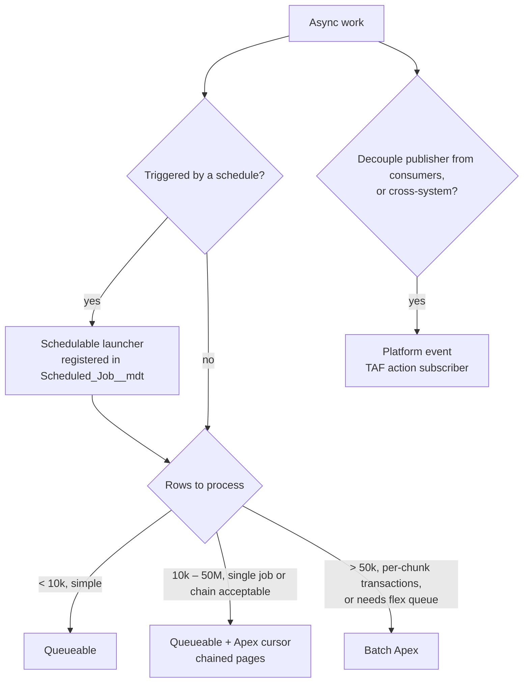

# 12 · Asynchronous Processing: Queueable, Batch, Scheduled

Based on the Salesforce Architects *Asynchronous Processing* decision guide. Async capacity is shared by every value stream and every installed package in the org, so it is governed centrally.

## 1. Rules

| ID | Rule |
| --- | --- |
| ASY-01 | **Queueable** is the default async mechanism. `@future` MUST NOT be used in new code (APX-49). |
| ASY-02 | **Batch Apex** is used for scheduled or bulk work over more than ~50k rows, or where per-chunk transactions are needed. Under that, use Queueable (with an Apex cursor for 10k–50M rows). |
| ASY-03 | Schedulable classes MUST be thin launchers: they enqueue a Queueable or start a Batch, nothing else. |
| ASY-04 | Every scheduled job MUST be registered in `Scheduled_Job__mdt` and scheduled by the `JobScheduleManager` (§5). Ad-hoc `System.schedule` calls from anonymous Apex or Setup are prohibited in production. |
| ASY-05 | Every async job MUST: set a Nebula scenario, link to its parent transaction, log failures, and save the log once (LOG-02, LOG-05). |
| ASY-06 | Every Queueable that can fail transiently (callouts, lock errors) MUST attach a **Transaction Finalizer** that handles retry or failure logging (§6). |
| ASY-07 | Every async job MUST be idempotent: rerunning it on the same input produces the same end state. |
| ASY-08 | A new scheduled job requires an ADR stating frequency, expected runtime, rows per run, running user and overlap behaviour. |
| ASY-09 | Enqueueing from trigger context MUST go through `AsyncDispatcher` (§3) so limits are checked and work is coalesced. |
| ASY-10 | Batch classes SHOULD implement `Database.RaisesPlatformEvents` and handle `BatchApexErrorEvent` through a TAF action for unhandled failures. |
| ASY-11 | `Database.Stateful` SHOULD be limited to counters and small Id sets. Large state goes into records or is recomputed. |
| ASY-12 | Scheduled and batch jobs MUST run as the dedicated automation user (an integration-style persona with no interactive login), so jobs survive staff changes. Their tests run as `TestPersonas.AUTOMATION` ([06 §6.2](06-testing-and-mocking.md#62-choosing-the-persona)). |
| ASY-13 | Jobs MUST check for an existing running instance before starting (single-instance guard) unless the ADR says concurrent runs are safe. |
| ASY-14 | Queueables chained from themselves MUST set `AsyncOptions.MaximumQueueableStackDepth` and SHOULD set a `QueueableDuplicateSignature` to prevent duplicate chains. |

## 2. Shared limits

| Limit | Value |
| --- | --- |
| Async Apex executions per 24 h (Batch, Queueable, Schedulable, future) | 250,000 or 200 × user licences, whichever is greater |
| Scheduled Apex jobs per org | 100 |
| Concurrent active/queued batch jobs | 5 (plus up to 100 in the Apex flex queue) |
| `System.enqueueJob` per sync transaction | 50 |
| `System.enqueueJob` per Queueable execution | 1 (child job) |
| Queueable delay | 0–10 minutes (`System.enqueueJob(job, delayMinutes)` or `AsyncOptions.MinimumQueueableDelayInMinutes`) |
| Batch `start` QueryLocator | 50M rows |
| Async CPU / heap | 60 s / 12 MB (check current release for heap) |

Installed packages consume the same allocation. Check `AsyncApexJob` usage before adding high-frequency jobs.

## 3. Enqueueing from trigger context

Problems this solves: hitting the enqueue limit in bulk DML (50 per sync transaction, 1 inside async contexts), and one job per 200-record trigger chunk.

```apex
public inherited sharing class AsyncDispatcher {
  /** Enqueue now if limits allow, otherwise defer via platform event. */
  public static Id enqueue(Queueable job) {
    if (canEnqueue()) {
      return System.enqueueJob(job);
    }
    EventBus.publish(new Async_Work_Requested__e(
      Job_Class__c = String.valueOf(job).substringBefore(':'),
      Payload__c = JSON.serialize(job)
    ));
    Logger.info('Queueable deferred via platform event: ' + String.valueOf(job).substringBefore(':'));
    return null;
  }

  private static Boolean canEnqueue() {
    return Limits.getQueueableJobs() < Limits.getLimitQueueableJobs();
  }
}
```

Coalesce first: TAF actions add Ids to a collector, and one DML finalizer ([03 §8](03-trigger-actions-framework.md#8-dml-finalizers)) enqueues a single job for the transaction. The platform event fallback is handled by a TAF action on `Async_Work_Requested__e` that rehydrates and enqueues the job. Payload classes must be JSON-serialisable.

## 4. Choosing an async mechanism



| Mechanism | Use for | Avoid for |
| --- | --- | --- |
| Queueable | Callouts after DML, post-commit processing, small/medium sets, chaining | Very large sets without a cursor |
| Queueable + `Database.Cursor` | Large sets processed in pages, with full control of page size and chaining | Work that needs `start/finish` semantics and flex queue management |
| Batch Apex | Scheduled bulk processing, purge, recalculation, > 50k rows | Near-real-time work (queue latency) |
| Platform event + TAF subscriber | Decoupled processing, retries with `EventBus.RetryableException`, high fan-out | Work needing an immediate result |
| Schedulable | Launch only | Doing work |
| `@future` | Nothing new | Everything |

### Apex cursor pattern

```apex
public with sharing class ContactPointCleanupQueueable implements Queueable {
  private static final Integer PAGE_SIZE = 2000;
  private final Database.Cursor cursor;
  private final Integer position;

  public ContactPointCleanupQueueable() {
    this(Database.getCursor(
      'SELECT Id FROM ContactPointEmail WHERE Is_Obsolete__c = true',
      AccessLevel.SYSTEM_MODE
    ), 0);
  }

  private ContactPointCleanupQueueable(Database.Cursor cursor, Integer position) {
    this.cursor = cursor;
    this.position = position;
  }

  public void execute(QueueableContext ctx) {
    Logger.setAsyncContext(ctx);
    Logger.setScenario('Platform.ContactPointCleanup');
    try {
      List<ContactPointEmail> page = (List<ContactPointEmail>) cursor.fetch(position, PAGE_SIZE);
      Database.delete(page, false, AccessLevel.SYSTEM_MODE);
      Integer next = position + page.size();
      if (next < cursor.getNumRecords()) {
        AsyncOptions opts = new AsyncOptions();
        opts.MaximumQueueableStackDepth = 5000;
        System.enqueueJob(new ContactPointCleanupQueueable(cursor, next), opts);
      }
    } finally {
      Logger.saveLog();
    }
  }
}
```

Cursors have their own limits (rows per cursor, fetch calls per transaction, cursors per day). Check the `Limits` cursor methods and the current Apex Developer Guide before using them on Tier 1 objects.

## 5. Scheduled jobs

### 5.1 Registry

`Scheduled_Job__mdt`:

| Field | Type | Purpose |
| --- | --- | --- |
| `DeveloperName` |  | Job key, also the `CronTrigger` name prefix |
| `Launcher_Class__c` | Text | Schedulable class |
| `Cron_Expression__c` | Text | Salesforce cron, e.g. `0 0 2 * * ?` |
| `Active__c` | Checkbox | Production on/off |
| `Active_In_Sandbox__c` | Checkbox | On/off in sandboxes |
| `Value_Stream__c` | Picklist | Owner |
| `Owner_Team__c` | Text | Support contact |
| `Expected_Runtime_Minutes__c` | Number | Monitoring threshold |
| `Allow_Concurrent__c` | Checkbox | Single-instance guard bypass (ASY-13) |
| `Description__c` | Long text | What the job does, ADR reference |

### 5.2 Schedule manager

`JobScheduleManager.syncAll()` aborts `CronTrigger` rows whose name matches a registry row and reschedules every active row. It is idempotent and runs:

-   after each deployment (post-deploy step in the pipeline, run as the automation user);
-   after each sandbox refresh (`SandboxPostCopy` implementation), which fixes schedules that refreshes leave broken or pointing at production endpoints;
-   on demand by the Platform team.

```apex
public with sharing class JobScheduleManager {
  public static void syncAll() {
    Boolean isSandbox = [SELECT IsSandbox FROM Organization LIMIT 1].IsSandbox;
    Map<String, Scheduled_Job__mdt> jobs = Scheduled_Job__mdt.getAll();
    Set<String> names = new Set<String>();
    for (String key : jobs.keySet()) names.add(cronName(key));

    for (CronTrigger ct : [
      SELECT Id, CronJobDetail.Name FROM CronTrigger WHERE CronJobDetail.Name IN :names
    ]) {
      System.abortJob(ct.Id);
    }
    for (Scheduled_Job__mdt job : jobs.values()) {
      Boolean active = isSandbox ? job.Active_In_Sandbox__c : job.Active__c;
      if (active) {
        Schedulable launcher = (Schedulable) Type.forName(job.Launcher_Class__c).newInstance();
        System.schedule(cronName(job.DeveloperName), job.Cron_Expression__c, launcher);
      }
    }
  }
  private static String cronName(String key) { return 'REG_' + key; }
}
```

The installed *Batch Job Scheduler* package is not used for new jobs. Jobs it schedules today move to the registry when touched.

### 5.3 Scheduling conventions

| Convention | Standard |
| --- | --- |
| Window | Heavy jobs run 22:00–05:00 local time. Spread start minutes to avoid the top of the hour. |
| Frequency | No job more often than every 15 minutes. Near-real-time needs use events. |
| Overlap | Launcher checks `AsyncApexJob` for a running instance of the same class (ASY-13). |
| Dependencies | Jobs that depend on another job are chained from the first job's `finish` or finalizer. Timing-based dependencies are prohibited. |
| Capacity | Total registry rows stay under 50, leaving headroom within the 100 scheduled job limit for packages. |

## 6. Error handling, retries and idempotency

### Transaction Finalizer

```apex
public with sharing class IntegrationRetryFinalizer implements Finalizer {
  private static final Integer MAX_ATTEMPTS = 3;
  private final IntegrationQueueableBase job;

  public IntegrationRetryFinalizer(IntegrationQueueableBase job) { this.job = job; }

  public void execute(FinalizerContext ctx) {
    if (ctx.getResult() == ParentJobResult.SUCCESS) return;
    Logger.setAsyncContext(ctx);
    if (job.getAttempt() < MAX_ATTEMPTS) {
      Integer delayMinutes = (Integer) Math.pow(2, job.getAttempt()); // 1, 2, 4
      System.enqueueJob(job.nextAttempt(), delayMinutes);
      Logger.warn('Retrying ' + ctx.getAsyncApexJobId() + ' attempt ' + (job.getAttempt() + 1), ctx.getException());
    } else {
      Logger.error('Job failed after ' + MAX_ATTEMPTS + ' attempts', ctx.getException()).addTag('AsyncFailure');
    }
    Logger.saveLog();
  }
}
```

### Idempotency techniques

| Technique | Use |
| --- | --- |
| Upsert on External Id | Integration writes |
| State field checked and set in the same transaction (`Sync_Status__c = 'Pending' → 'Sent'`) | Outbound sync |
| Process only rows matching "not yet processed" criteria | Batch jobs and purge |
| `QueueableDuplicateSignature` | Prevent the same job being queued twice |
| Platform event replay with `EventBus.TriggerContext.setResumeCheckpoint` | Event subscribers |

### Batch error handling

-   `execute` uses partial-success DML and logs failures (APX-34).
-   `finish` logs a summary (`Logger.info` with counts) and chains the next job if any.
-   `Database.RaisesPlatformEvents` publishes `BatchApexErrorEvent` for unhandled exceptions. A TAF action on `BatchApexErrorEvent` logs it to Nebula with the job Id and failed scope Ids.

## 7. Monitoring

| What | How |
| --- | --- |
| Failed jobs | Nebula logs tagged `AsyncFailure`; `AsyncApexJob` where `Status = 'Failed'` in a daily report |
| Long-running jobs | Compare `AsyncApexJob` duration with `Expected_Runtime_Minutes__c` |
| Capacity | Daily async execution usage (`/limits` REST resource: `DailyAsyncApexExecutions`) |
| Schedules present | Post-deploy and post-refresh check: every active registry row has a `CronTrigger` |
| Flex queue depth | `AsyncApexJob` where `Status = 'Holding'` |
