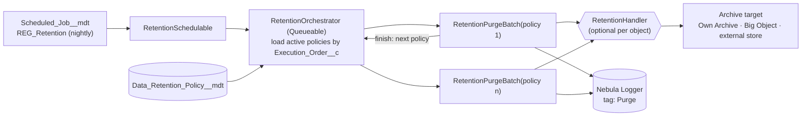

# 13 · Data Retention and Purge

One metadata-driven engine purges or archives records for every object. New per-object purge batches MUST NOT be written. Teams add a policy row; the engine does the rest.

## 1. Rules

| ID | Rule |
| --- | --- |
| RET-01 | Every custom object, and every standard object a value stream creates records in at volume, MUST have a `Data_Retention_Policy__mdt` row (active or explicitly "Retain indefinitely" with a reason). |
| RET-02 | Record deletion for retention MUST use the generic purge engine (§3). Object-specific purge batches MUST NOT be created. Object-specific logic goes in a `RetentionHandler` subclass. |
| RET-03 | Retention periods MUST be approved by the data's business owner and aligned to the University's records management obligations (Public Records Act 2023 (Qld) and the applicable retention and disposal schedule; confirm with Records Management). The approval is recorded in the policy's `Approval_Reference__c`. |
| RET-04 | A new or changed policy MUST run in **dry-run** mode in production for at least one cycle, and the dry-run count MUST be reviewed before it is set live. |
| RET-05 | Policies MUST filter on an indexed date field (`CreatedDate`, `SystemModstamp`, or an indexed custom date) so `start` queries are selective. |
| RET-06 | Records under legal hold or with an active relationship flagged by the policy's `Hold_Field__c` MUST be excluded. |
| RET-07 | Child policies MUST run before parent policies (`Execution_Order__c`) where children are on lookups with *restrict delete* or where cascade volume would breach limits. |
| RET-08 | Hard delete (`emptyRecycleBin`) is used only where the policy says so and a backup or archive exists for the period required by RET-03. |
| RET-09 | Each run MUST log a per-policy summary (selected, deleted, failed, archived) to Nebula Logger with tag `Purge`. |
| RET-10 | Objects whose lifecycle is owned by a package (Nebula logs, managed package logs with their own purge settings) use the package mechanism. They are recorded in the registry with `Action__c = Managed Externally` for completeness. |

## 2. Why one engine

| Per-object batches | Generic engine |
| --- | --- |
| One class, test, schedule and scheduled-job slot per object | One engine, one schedule, one test suite |
| Inconsistent safety (dry run, caps, holds) | Same safety controls for every object |
| Retention rules hidden in code | Retention rules visible and reviewable in metadata |
| Hard to report "what do we delete, and when" | Registry is the report |

## 3. Architecture



Policies run one at a time (each batch chains the orchestrator in `finish`), so the engine uses one batch slot and never floods the flex queue.

### 3.1 `Data_Retention_Policy__mdt`

| Field | Type | Purpose |
| --- | --- | --- |
| `Object_API_Name__c` | Text | Target object, e.g. `STG_Webform__c` |
| `Date_Field__c` | Text | Indexed date/datetime field for age, e.g. `CreatedDate` |
| `Retention_Days__c` | Number | Age after which records are eligible |
| `Filter__c` | Long text | Extra SOQL `WHERE` fragment, e.g. `Processing_Status__c = 'Processed'`. Validated at runtime (§3.3). |
| `Hold_Field__c` | Text | Optional checkbox field; records where it is true are skipped |
| `Action__c` | Picklist | `Delete` · `Hard Delete` · `Archive Then Delete` · `Anonymise` · `Retain Indefinitely` · `Managed Externally` |
| `Handler_Class__c` | Text | Optional `RetentionHandler` subclass |
| `Batch_Size__c` | Number | Batch scope (default 200) |
| `Max_Records_Per_Run__c` | Number | Cap per nightly run (default 500,000) |
| `Execution_Order__c` | Number | Lower runs first |
| `Bypass_Triggers__c` | Checkbox | Bypass TAF actions on this object during purge |
| `Dry_Run__c` | Checkbox | Count and log only |
| `Active__c` | Checkbox | On/off |
| `Value_Stream__c` | Picklist | Owner |
| `Business_Owner__c` | Text | Role of the approver |
| `Approval_Reference__c` | Text | Records management / ADR reference |
| `Description__c` | Long text | What is purged and why |

### 3.2 Handler extension point

```apex
/** Override only what an object needs. Defaults delete everything selected. */
public virtual inherited sharing class RetentionHandler {
  /** Fields the batch must query for isEligible/archive, in addition to Id. */
  public virtual Set<String> additionalFields() { return new Set<String>(); }

  /** Per-record check after the SOQL filter, e.g. "no open child cases". Must be bulk-safe: called once per scope. */
  public virtual List<SObject> filterEligible(List<SObject> scope) { return scope; }

  /** Archive or export before delete. Throwing stops deletion of this scope. */
  public virtual void archive(List<SObject> eligible) {}

  /** Anonymise in place (Action = Anonymise). */
  public virtual void anonymise(List<SObject> eligible) {
    throw new RetentionException('Anonymise requires a handler');
  }
}
```

### 3.3 Purge batch (illustrative)

```apex
// without sharing: runs as the automation user and must see every eligible record (APX-20, APX-22)
public without sharing class RetentionPurgeBatch implements Database.Batchable<SObject>, Database.Stateful, Database.RaisesPlatformEvents {
  private final Data_Retention_Policy__mdt policy;
  private final RetentionHandler handler;
  private Integer selected = 0, deleted = 0, failed = 0;

  public RetentionPurgeBatch(Data_Retention_Policy__mdt policy) {
    this.policy = policy;
    this.handler = String.isBlank(policy.Handler_Class__c)
      ? new RetentionHandler()
      : (RetentionHandler) Type.forName(policy.Handler_Class__c).newInstance();
  }

  public Database.QueryLocator start(Database.BatchableContext ctx) {
    RetentionQueryBuilder qb = new RetentionQueryBuilder(policy, handler.additionalFields()); // validates object, fields, filter
    return Database.getQueryLocatorWithBinds(qb.soql(), qb.binds(), AccessLevel.SYSTEM_MODE);
  }

  public void execute(Database.BatchableContext ctx, List<SObject> scope) {
    Logger.setAsyncContext(ctx);
    Logger.setScenario('Platform.Retention.' + policy.DeveloperName);
    List<SObject> eligible = handler.filterEligible(scope);
    selected += eligible.size();
    if (policy.Dry_Run__c || eligible.isEmpty()) {
      Logger.saveLog();
      return;
    }
    if (policy.Bypass_Triggers__c) TriggerBase.bypass(policy.Object_API_Name__c);
    try {
      switch on policy.Action__c {
        when 'Archive Then Delete' { handler.archive(eligible); deleteAll(eligible, false); }
        when 'Delete'              { deleteAll(eligible, false); }
        when 'Hard Delete'         { deleteAll(eligible, true); }
        when 'Anonymise'           { handler.anonymise(eligible); }
      }
    } catch (Exception e) {
      failed += eligible.size();
      Logger.error('Retention scope failed: ' + policy.DeveloperName, e).addTag('Purge');
    } finally {
      if (policy.Bypass_Triggers__c) TriggerBase.clearBypass(policy.Object_API_Name__c);
      Logger.saveLog();
    }
  }

  private void deleteAll(List<SObject> records, Boolean hard) {
    List<Database.DeleteResult> results = Database.delete(records, false, AccessLevel.SYSTEM_MODE);
    List<Id> ok = new List<Id>();
    for (Integer i = 0; i < results.size(); i++) {
      if (results[i].isSuccess()) {
        ok.add(records[i].Id);
      } else {
        failed++;
        Logger.warn('Retention delete failed', records[i].Id).setDatabaseResult(results[i]).addTag('Purge');
      }
    }
    deleted += ok.size();
    if (hard && !ok.isEmpty()) Database.emptyRecycleBin(ok);
  }

  public void finish(Database.BatchableContext ctx) {
    Logger.info(String.format('Retention {0}: selected={1} deleted={2} failed={3} dryRun={4}',
      new List<Object>{ policy.DeveloperName, selected, deleted, failed, policy.Dry_Run__c })).addTag('Purge');
    Logger.saveLog();
    RetentionOrchestrator.continueAfter(policy); // enqueue next policy by Execution_Order__c
  }
}
```

`RetentionQueryBuilder` produces:

```sql
SELECT Id {, additionalFields}
FROM {Object_API_Name__c}
WHERE {Date_Field__c} < :cutoff
  {AND Hold_Field__c = false}
  {AND (Filter__c)}
ORDER BY {Date_Field__c}
LIMIT :maxRecords
```

Validation before the batch starts:

-   object and every field exist (describe), and the object is deletable;
-   the object is not on the engine's **protected list** (setup objects such as `User`, `Group`, `PermissionSet*`; `Organization`; Nebula `Log__c`/`LogEntry__c`; any object listed in a `Retention_Protected_Object__mdt`);
-   `Filter__c` contains no `;`, subqueries, `LIMIT` or `ORDER BY`, and a `SELECT Id ... LIMIT 1` test query succeeds;
-   `Date_Field__c` is a date or datetime field.

Policies are deployed metadata, changed only through PRs approved by the business owner, so `Filter__c` is trusted input. The checks above stop mistakes.

## 4. Archive options

| Option | Use when | Retrieval | Notes |
| --- | --- | --- | --- |
| **Own Archive** (installed, `OB_Archiver`) | Business records needing in-context retrieval by users after removal | Via Own Archive UI / restore | Policy `Action__c = Managed Externally` if Own Archive runs the deletion; or `Archive Then Delete` with a handler calling Own Archive. Agree one owner per object. |
| **Big Object** | High-volume, append-only history needed in-platform for audit (e.g. integration staging snapshots) | Async SOQL is retired; query on the Big Object index only | Write with `Database.insertImmediate`. Index fields chosen for retrieval queries. Not reportable in standard reports. |
| **External store** (data lake/warehouse via middleware or Bulk API 2.0 extract) | Analytics or records retention outside Salesforce | External tools | Extract before the purge window; handler verifies the extract marker before delete. |
| **Field Audit Trail** | Field history beyond 18–24 months | Field history archive | Shield. Retention policy set per object in FAT. |
| **Backup only** | Data has no retrieval need but recovery from error is required | Restore from backup | Backup tool retention must cover the recovery window. |

## 5. Platform behaviour to account for

| Topic | Behaviour |
| --- | --- |
| Recycle Bin | Soft-deleted records stay for 15 days (subject to bin capacity). Hard delete removes them immediately. |
| `emptyRecycleBin` | Max 10,000 records per call. |
| Cascade delete | Deleting a master deletes details. Cascaded rows are not counted in the batch scope but do hit locks and CPU. Purge large children first (RET-07). |
| Restrict delete lookups | Delete fails with `DELETE_FAILED`. Purge the referencing records first or clear the lookup in the handler. |
| Person Accounts | Deleting the Account deletes the Contact. Person data purge goes through a dedicated policy with privacy review. |
| Files | Delete `ContentDocument` (removes all versions and links). Deleting a parent record does not delete files shared elsewhere. |
| Activities | Tasks and Events over 365 days old are archived by Salesforce (`IsArchived = true`). Query with `ALL ROWS` to include them. |
| Storage accounting | Most records count as 2 KB. Person Accounts count 4 KB. Campaigns 8 KB. |
| Sharing rows | Deleting records deletes their share rows. Large deletes trigger sharing cleanup load. Run in the overnight window. |
| Bulk API hard delete | Requires the *Bulk API Hard Delete* permission (high-privilege). The engine does not need it. |

## 6. Storage impact of candidate policies

Estimated at 2 KB per record, from [10 §2](10-large-data-volumes.md#2-our-volumes). Retention periods below are **proposals** for business owners to confirm under RET-03.

| Object | Rows | Est. storage | Candidate policy |
| --- | --- | --- | --- |
| CampaignMember | 8.08M | ~16 GB | Members of completed mass-communication campaigns older than N years. Archive engagement summary first if needed. |
| Ascend Salutation | 4.00M | ~8 GB | Vendor-managed. Confirm with Kindsight whether historic salutations can be purged. |
| Ascend `Log__c` | 1.92M | ~3.8 GB | Use the package's own log retention if available (RET-10); otherwise `Delete` older than 90 days. |
| et4ae5 IndividualEmailResult | 1.50M | ~3 GB | Results older than 2 years, after engagement data is held in Marketing Cloud. |
| `STG_Enrollment__c` / `STG_Application__c` / `STG_Webform__c` | 810k / 262k / 89k | ~2.3 GB | `Filter__c = Processing_Status__c = 'Processed'`, older than 90 days. |
| Task (unrelated to a record) | ~502k | ~1 GB | Older than N years, `WhatId = null AND WhoId = null`. |
| Nebula `Log__c` / `LogEntry__c` | 36k / 136k | small | Nebula `LogBatchPurger` (RET-10) |

## 7. Operating the engine

| Activity | Owner | Frequency |
| --- | --- | --- |
| Review purge summaries (`Purge` tag dashboard) | Platform team | Weekly |
| Review dry-run results for new policies | Business owner + Platform | Before go-live of each policy |
| Review storage trend vs policies | Platform architect | Quarterly |
| Recertify retention periods | Business owners + Records Management | Annually |
| Emergency stop | Platform team | Set `Active__c = false` on the policy, or deactivate `REG_Retention` in `Scheduled_Job__mdt` and run `JobScheduleManager.syncAll()` |

## 8. Testing the engine

All engine tests run as `TestPersonas.AUTOMATION`, the user the nightly job runs as (TST-16, ASY-12). This proves the automation persona holds delete access on every object a policy targets.

-   Unit tests for `RetentionQueryBuilder` covering each validation failure.
-   A test policy on a test-only custom object (or on a standard object using in-test custom metadata injection) covering: dry run, delete, hard delete, hold field, handler `filterEligible`, handler archive failure stopping delete, partial delete failure logging.
-   Each `RetentionHandler` subclass has its own unit test.
